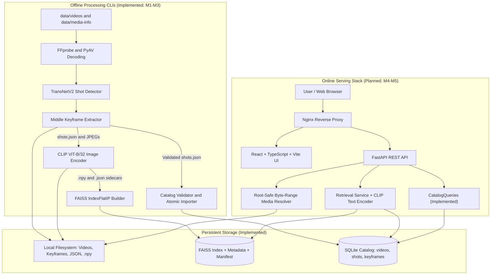
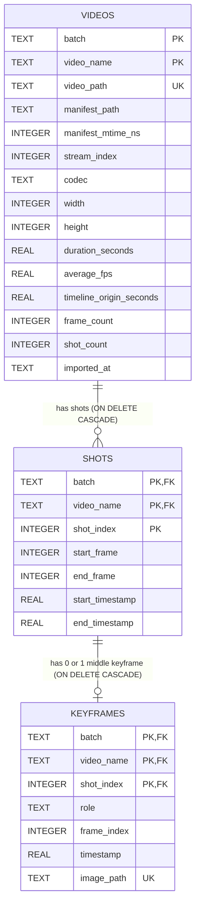

# AIC2026 — Comprehensive Technical Summary & Internship Interview Guide

> **Purpose:** Single-source technical review of the **AIC2026** multimodal video retrieval system—covering its competition context, technology stack, end-to-end architecture, every implemented module and function, test suite, architectural trade-offs, and targeted interview prep for **Software Engineering**, **Backend Engineering**, and **AI / ML Engineering** internship roles.
>
> **Scope Note (Implemented vs. Planned):** This summary strictly separates **implemented, tested functionality (Milestones M1–M3)** from **designed/planned components (Milestones M4–M7)** so every claim in technical interviews matches verified code on disk.

---

## 1. Executive Summary & Project Context

### 1.1 What Is AIC2026?

**AIC2026** is a local, single-user multimodal AI video retrieval system motivated by the **Ho Chi Minh City AI Challenge 2026 (HCM AI Challenge 2026)**. It processes raw competition videos into shot boundaries and representative full-resolution keyframes, encodes keyframes into L2-normalized CLIP embeddings, indexes them with FAISS for fast semantic search, and persists validated video/shot/keyframe metadata in a SQLite catalog.

The initial corpus target is approximately **100 videos**, designed to stay practical as the collection scales toward **1,000 videos** on a single developer/researcher workstation.

### 1.2 Competition Domain Context (`docs/Thong-tin-vong-So-tuyen-AIC2026.pdf`)

The HCM AI Challenge preliminary round defines three query types over a large broadcast/news video library (up to **100 ranked answers** submitted per query):

1. **Textual Known-Item Search (Textual KIS):**
   - *Input:* Natural-language description of an event.
   - *Output:* `<video_id>, <frame_id>` matching a frame within the ground-truth interval `[s, e]`.
   - *R-Score:* Binary `1` if `v_i == GT_v` and `id_i in [s, e]`, else `0`.
2. **Visual Question Answering (VQA):**
   - *Input:* Natural-language event description plus a factual question (answerable in Vietnamese or English).
   - *Output:* `<video_id>, <frame_id>, <answer>`.
   - *R-Score:* Binary `1` if video matches, frame lies in `[s, e]`, and answer matches ground truth semantically.
3. **Temporal Retrieval and Alignment of Key Events (TRAKE):**
   - *Input:* Ordered multi-event narrative sequence (e.g., high-jump *Approach → Take-off → Clearance → Landing*).
   - *Output:* `<video_id>, <frame_id_1>, ..., <frame_id_N>` locating one exact semantic keyframe per stage (typically tight windows `< 10` frames wide).
   - *R-Score:* `0` immediately if `v_i != GT_v`; otherwise fractional accuracy `(1 / N) * sum_j I(id_{i,j} in [s_j, e_j])`.

**Ranking & Final Evaluation Metric:**

For each query, submissions are evaluated at cutoffs `k in {1, 5, 20, 50, 100}`:

- `R@k = max_{1 <= i <= k} R-Score(r_i)`
- `Final Score = (1 / 5) * sum_{k in {1, 5, 20, 50, 100}} R@k`

This heavily rewards systems that rank the exact video and tight temporal moment near the top of the list rather than merely retrieving it somewhere in the top 100.

### 1.3 Implementation Status vs. Roadmap (M1–M7)

| Milestone | Scope | Current Status | Key Files / Evidence |
| --- | --- | --- | --- |
| **M1 — Video Processing** | Video probing, display-order PyAV decoding, TransNetV2 shot detection, one full-res middle keyframe per shot, `shots.json`, atomic staging/locking, Docker CPU/GPU | **Implemented** | `data_processing/phase1_keyframe_extraction/` |
| **M2 — Embeddings & Indexing** | `BaseEmbedding` interface, CLIP ViT-B/32 adapter, Phase 1 pre-validation, normalized `.npy` + `.json` provenance, global + playlist FAISS `IndexFlatIP` | **Implemented** | `data_processing/phase2_feature_extraction/` |
| **M3 — SQLite Catalog** | SQLAlchemy 2.x models (`videos`, `shots`, `keyframes`), Alembic migration `0001`, pre-DB validation, locked atomic importer, `CatalogQueries`, import CLI | **Implemented** | `backend/app/database.py`, `models.py`, `catalog/`, `migrations/` |
| **M4 — Snapshot Validation & Retrieval** | Validate FAISS index + manifest + row metadata + Phase 1/2 provenance at startup; reusable Python text-to-keyframe top-K retrieval | **Planned** | Specified in `docs/05_BACKEND_ARCHITECTURE.md`, `06_DATABASE.md`, `TODOS.md` |
| **M5 — FastAPI API & React UI** | REST endpoints (`/api/v1/*`, `/health/*`), root-safe media serving with HTTP `Range` byte-range seeking, React + TS + Vite + Tailwind behind Nginx | **Planned** | `backend/app/api/`, `backend/app/services/`, `frontend/` currently empty |
| **M6 — Optional Visual Analysis** | Object detector or VLM inspection/counting over selected keyframes with explicit provenance and uncertainty bounds | **Planned** | `docs/TODOS.md` |
| **M7 — Evaluation & Polish** | Ground-truth query set, Recall@K measurement, extraction/query latency & memory benchmarks, README/diagram polish | **Planned** | `docs/TODOS.md` |

### 1.4 Verified Local Workspace Snapshot

Observed directly on disk in this repository:

- **Raw Inputs (`data/`):**
  - `20` MP4 videos under `data/videos/Videos_L21/` (`L21_V001.mp4` .. `L21_V030.mp4` subset).
  - `873` organizer YouTube metadata files under `data/media-info/*.json` (HTV *60 Giây* news broadcasts).
  - `873` organizer keyframe CSVs under `data/map-keyframes/*.csv` (`n,pts_time,fps,frame_idx`).
- **Processed Artifacts (`data_processed/`):**
  - **Phase 1 (`transnetv2/` + `keyframes/`):** `L21_V001` (`1280x720`, H.264, `1261.73s`, `37,849` frames, `336` shots) and `L21_V002` (`1280x720`, `1057.41s`, `31,720` frames, `281` shots).
  - **Phase 2 (`features/clip/`):** `L21_V001.npy` (`336 x 512` float32 = `688,256` bytes) and `L21_V001.json` (extracted on `cuda` in ~`10.79s`).
  - **FAISS Index (`indexes/`):** `clip_keyframe_embedding.index` (`336` vectors, `dim=512`, `688,173` bytes), `clip_keyframe_metadata.json`, `clip_keyframe_index.json` (`index_version: "faiss-flat-ip-v1"`).
  - **SQLite Catalog (`database/catalog.sqlite3`):** Migrated to Alembic revision `0001`; contains `2` videos, `617` shots, and `617` keyframes (`L21_V001` + `L21_V002`).
  - **Legacy Artifact:** `data_processed/map-keyframes/L21_V001.csv` remains from an earlier layout prior to `phase1-middle-v3`.

---

## 2. Complete Technology Stack

| Layer | Technology / Package | Version / Spec (`pyproject.toml` & Files) | Status | Role in AIC2026 |
| --- | --- | --- | --- | --- |
| **Language & Env** | Python + `uv` / `uv_build` | Python `3.14` (`.python-version`) | **Active** | Runtime, dependency locking (`uv.lock`), workspace CLI execution |
| **Video Probing** | FFmpeg / `ffprobe` | System binary | **Active** | Stream inspection (codec, resolution, duration, timeline origin, rotation check) |
| **Video Decoding** | PyAV (`av`) | `>=19.0.1` | **Active** | Multithreaded FFmpeg display-order frame decoding without resampling |
| **Image I/O** | Pillow (`PIL`) | `>=12.3.0` | **Active** | Full-res JPEG saving (`quality=95, subsampling=0`), image verification, RGB conversion |
| **Shot Detection** | TransNetV2 (PyTorch, vendored) | Commit `b4927ebfa...` | **Active** | 3D DDCNN + frame-similarity + color-histogram boundary prediction on `48x27` frames |
| **Deep Learning** | PyTorch + `transformers` | `torch==2.14.0`, `transformers>=5.0.0` | **Active** | Inference runtime + Hugging Face `CLIPModel` / `CLIPProcessor` (`openai/clip-vit-base-patch32`) |
| **Numerics** | NumPy | `>=2.5.3` | **Active** | Frame stacks, timestamp arrays, float32 L2-normalized embedding matrices (`.npy`) |
| **Vector Search** | `faiss-cpu` | `>=1.13.2` | **Active** | Exact cosine similarity via `faiss.IndexFlatIP` on L2-normalized 512d vectors |
| **Database & ORM** | SQLite + SQLAlchemy 2.x | `sqlite+pysqlite`, `sqlalchemy>=2.1.3` | **Active** | Declarative ORM (`Video`, `Shot`, `Keyframe`), Core upserts, `PRAGMA` connection hooks |
| **Migrations** | Alembic | `>=1.20.0` | **Active** | Versioned schema migrations (`0001`), `-x database_path=...` support, drift checking |
| **Containers** | Docker & Docker Compose | `python:3.14-slim`, BuildKit cache | **Active (Phase 1)** | Reproducible CPU and CUDA (`cu130`) Phase 1 execution with read-only `/app/data` |
| **Testing** | Pytest + `httpx` | `pytest>=9.1.1`, `httpx>=0.28.1` | **Active** | Unit, integration, migration, rollback, and CLI contract tests (`7` test modules) |
| **Web Backend** | FastAPI + Uvicorn + Pydantic Settings | `fastapi>=0.142.2`, `uvicorn>=0.54.0`, `pydantic-settings>=2.15.0` | **Installed (M5 Planned)** | Planned REST API, OpenAPI schema, lifespan artifact loading, HTTP byte-range streaming |
| **Legacy DB Deps** | `pgvector`, `psycopg[binary]` | `>=0.5.0`, `>=3.3.6` | **Unused / Legacy** | Leftover in `pyproject.toml` from an earlier PostgreSQL/pgvector design (replaced by SQLite + FAISS) |
| **Web Frontend & Proxy** | React + TypeScript + Vite + Tailwind + Nginx | Not yet scaffolded | **Planned (M5)** | Browser query UI, thumbnail grid, video player timestamp seeking, HTTPS/reverse proxy |

---

## 3. System Architecture & Data Flow

### 3.1 End-to-End Architecture



### 3.2 Storage Boundaries & Source-of-Truth Contracts

| Store | Directory / File Pattern | Authority & Mutability | Design Rule |
| --- | --- | --- | --- |
| **Competition Inputs** | `data/videos/<batch>/<video_name>.<ext>` | **Read-only source** | Never modified by code; CLIs explicitly reject output paths under `data/`. |
| **Phase 1 Artifacts** | `data_processed/transnetv2/<batch>/<video_name>/shots.json` (plus `.predictions.txt`, `.scenes.txt`, optional `.vis.png`) and `data_processed/keyframes/<batch>/<video_name>/00000.jpg` | **Reproducible source for catalog & Phase 2** | Atomic staging + backup publish; holds full technical metadata, shot bounds, and decoded presentation timestamps (PTS). |
| **Phase 2 Features** | `data_processed/features/<model_key>/<video_name>.npy` and `.json` | **Reproducible source for FAISS rebuilds** | Per-video L2-normalized `float32` matrices + model/input provenance (`input_shots_mtime_ns`). |
| **FAISS Snapshots** | `data_processed/indexes/<model_key>_keyframe_embedding.index`, `_metadata.json`, `_index.json` (plus optional `playlist/`) | **Rebuildable derived search artifact** | Row indices are **ephemeral**; never stored in SQLite. Always validated with their companion JSON metadata and manifest. |
| **SQLite Catalog** | `data_processed/database/catalog.sqlite3` | **Queryable application catalog** | Synchronized via Alembic migrations + validated atomic imports from Phase 1 JSON; stores relative POSIX keys only (no absolute paths or vector blobs). |

### 3.3 SQLite Database Schema & Entity Relationships



Key schema invariants enforced in both `backend/app/models.py` and Alembic migration `0001`:

- **Natural Composite Keys:** Videos use `(batch, video_name)`; shots use `(batch, video_name, shot_index)`; keyframes reuse `(batch, video_name, shot_index)` as both Primary Key and Foreign Key to `shots`—structurally enforcing **1-to-0..1** shot-to-keyframe cardinality in SQLite.
- **Lookup Index:** `ix_videos_video_name` on `videos(video_name)` supports fast lookups and cross-batch duplicate detection.
- **Database-Level `CHECK` Constraints:**
  - `videos`: `width > 0`, `height > 0`, `duration_seconds > 0`, `frame_count > 0`, `shot_count > 0`.
  - `shots`: `shot_index >= 0`, `start_frame >= 0`, `end_frame >= start_frame`, `start_timestamp >= 0`, `end_timestamp >= start_timestamp`.
  - `keyframes`: `shot_index >= 0`, `frame_index >= 0`, `role = 'middle'` (`ck_keyframes_role_middle`), `timestamp >= 0`, `UNIQUE(image_path)`.
- **Referential Integrity:** Every SQLite connection forces `PRAGMA foreign_keys = ON` and `PRAGMA busy_timeout = 5000`.

### 3.4 Repository Directory Map

```text
AIC2026/
├── pyproject.toml                        # Project deps, uv_build config (backend, data_processing), pytest/httpx dev deps
├── alembic.ini                           # Points Alembic to backend/migrations
├── README.md                             # Quickstart CLI commands & M3 status
├── data/                                 # Competition inputs (20 videos, 873 media-info JSONs, 873 map-keyframes CSVs)
├── data_processed/                       # Generated pipeline artifacts, SQLite DB, features, FAISS indexes
├── docs/                                 # Architecture & design specs (01..06, TODOS.md, competition PDF)
├── papers/                               # 3 reference VBS / multimodal retrieval PDFs
├── test/transnetv2_pytorch/              # Local upstream reference checkout used by AST parity test
├── data_processing/
│   ├── cli.py                            # Unified CLI dispatching transnetv2, phase1, phase2
│   ├── phase1_keyframe_extraction/
│   │   ├── cli.py                        # Standalone Phase 1 CLI (Docker entrypoint)
│   │   ├── metadata.py                   # FFprobe probing & PyAV display-order decoding
│   │   ├── transnet.py                   # Shot detection runner, file I/O & array validator
│   │   ├── keyframes.py                  # Middle frame selection, JPEG extraction & validation
│   │   ├── pipeline.py                   # Discovery, locking, staging, atomic publication & skip logic
│   │   ├── Dockerfile & compose.yaml     # CPU and GPU container definitions
│   │   └── transnetv2/                   # Vendored TransNetV2 model.py, inference.py, weights.pth, UPSTREAM.md
│   └── phase2_feature_extraction/
│       ├── base_embedding.py             # Abstract BaseEmbedding interface & ImageInput TypeAlias
│       ├── clip_embedding.py             # Hugging Face CLIP ViT-B/32 adapter
│       ├── pipeline.py                   # Phase 1 pre-validation, batched encoding, atomic .npy/.json publish
│       └── build_index.py                # Global + optional playlist FAISS IndexFlatIP builder
├── backend/
│   ├── app/
│   │   ├── database.py                   # SQLite engine & sessionmaker factory with PRAGMA hooks
│   │   ├── models.py                     # SQLAlchemy 2.x Declarative models (Video, Shot, Keyframe)
│   │   ├── catalog/
│   │   │   ├── validation.py             # Pre-DB artifact validation & TOCTOU signature checks
│   │   │   ├── importer.py               # Locked atomic per-video SQLite importer
│   │   │   ├── queries.py                # Detached typed pagination queries (CatalogQueries)
│   │   │   └── cli.py                    # Catalog import CLI
│   │   ├── api/                          # Empty placeholder for M5 FastAPI routers
│   │   └── services/                     # Empty placeholder for M4/M5 retrieval & media services
│   └── migrations/
│       ├── env.py                        # Alembic environment reusing create_catalog_engine
│       └── versions/0001_create_video_shot_and_keyframe_catalog.py
├── frontend/                             # Empty placeholder for M5 React + TS + Vite UI
└── tests/                                # 7 pytest suites covering M1, M2, and M3
```

### 3.5 Planned HTTP API & Serving Contracts (`docs/05_BACKEND_ARCHITECTURE.md`)

When M4/M5 are implemented, the FastAPI layer is designed around thin HTTP routes over Python services:

| Method & Route | Planned Behavior |
| --- | --- |
| `GET /health/live` | Liveness check confirming the FastAPI process is running. |
| `GET /health/ready` | Reports SQLite catalog readiness and search readiness (CLIP + FAISS compatibility) independently. |
| `GET /api/v1/videos` | Paginated catalog listing sorted by `(batch, video_name)` via `CatalogQueries`. |
| `GET /api/v1/videos/{video_name}` | Video metadata, counts, and processing settings (requiring batch disambiguation if needed). |
| `GET /api/v1/videos/{video_name}/keyframes` | Keyframes ordered by `shot_index`. |
| `POST /api/v1/search` | Validates nonempty query + bounded `top_k`, encodes text with matching CLIP model, queries FAISS, cross-checks SQLite rows. |
| `GET /api/v1/media/keyframes/{video_name}/{name}` | Serves JPEG keyframe files safely beneath approved `PROCESSED_ROOT`. |
| `GET /api/v1/media/videos/{video_name}` | Serves source video beneath `VIDEO_ROOT` with HTTP `Range` byte-range support for browser timestamp seeking. |

Error contract: controlled `404` (missing record/file), `422` (invalid input), `503` (unavailable search snapshot), `500` (unexpected error) with zero absolute host paths or stack traces leaked.

---

## 4. Module-by-Module & Function-by-Function Reference

### 4.1 Unified Offline CLI (`data_processing/cli.py`)

- `main(argv=None) -> int`
  - Builds a unified `argparse` parser combining Phase 1 subcommands (`transnetv2`, `phase1` via `add_commands`) and `phase2`.
  - **CLI Guards:** Rejects providing both positional `input` and `--batch`; enforces `--batch` matches regex `Videos_L\d+`; normalizes `--device gpu` to `"cuda"`.
  - **Phase 2 Execution:** Invokes `phase2_feature_extraction.pipeline.run_pipeline`, prints `"Processed: {processed}; skipped: {skipped}; failed: {failed}"`, returns `1` on errors or failed videos, `130` on `KeyboardInterrupt`, and `0` on full success.

---

### 4.2 Phase 1 — Video Processing & Keyframe Extraction (`data_processing/phase1_keyframe_extraction/`)

#### `cli.py`
- `add_commands(commands) -> None`: Registers `transnetv2` (shot detection only) and `phase1` (shot detection + middle keyframe extraction) parsers with options `--batch`, `--output-root`, `--weights`, `--device`, `--threshold`, `--force`, `--visualize`.
- `run(args) -> int`: Resolves default input (`PROJECT_ROOT/data/videos`) and invokes `pipeline.run_pipeline`.
- `main(argv=None) -> int`: Standalone CLI entrypoint used inside the Docker container (`python -m data_processing.phase1_keyframe_extraction.cli`) so the image does not depend on parent package files.

#### `metadata.py`
- `VIDEO_EXTENSIONS = {".mp4", ".mkv", ".avi", ".mov", ".webm", ".flv"}`.
- `probe_video(path: Path) -> dict`:
  - Executes `ffprobe -v error -show_streams -show_format -of json`.
  - Picks the first stream where `codec_type == "video"` and `disposition.attached_pic` is falsy (skipping embedded cover art).
  - Checks `side_data_list[*].rotation` and `tags.rotate`; raises `ValueError` if any rotation `% 360 != 0` to avoid ambiguous orientation.
  - Validates finite positive `duration` and finite `timeline_origin_seconds` (`format.start_time` fallback `stream.start_time`), and parses rational `avg_frame_rate` (`num/den`).
- `iter_video_frames(path: Path, metadata: dict)`:
  - Opens video with `av.open`, selects `metadata["stream_index"]`, sets `thread_type = "AUTO"`, `thread_count = 4`, and decodes in **display order without resampling**.
  - Rejects corrupt frames, missing `pts`/`time_base`, mid-stream resolution changes, nonfinite or negative (`< -1e-6`) timestamps, or non-monotonic PTS regression.
  - Computes true playback timestamp: `max(0.0, float(frame.pts * frame.time_base) - metadata["timeline_origin_seconds"])`.
- `decode_for_detection(path: Path, metadata: dict) -> tuple[np.ndarray, np.ndarray]`:
  - Converts each decoded frame to `48x27` `rgb24` via bicubic scaling (`frame.to_ndarray(width=48, height=27, format="rgb24", interpolation="BICUBIC")`), stacking into `[N, 27, 48, 3]` `uint8` plus a `float64` timestamp vector. Rejects empty videos.

#### `transnetv2/model.py` (Vendored PyTorch Architecture)
- `TransNetV2(nn.Module)`: Hyperparameters `F=16, L=3, S=2, D=1024`. Accepts `uint8` tensor `[B, T, 27, 48, 3]`, normalizes to `[B, 3, T, 27, 48] / 255.0`, passes through `L=3` `StackedDDCNNV2` blocks (spatial downsampling reduces `27x48` to `3x6`), optionally concatenates `FrameSimilarity` (`128d`) and `ColorHistograms` (`128d`), projects via `fc1` -> `ReLU` -> `Dropout(0.5)`, and outputs `cls_layer1` (`one_hot` transition logits) and `cls_layer2` (`many_hot` transition logits).
- `StackedDDCNNV2`: Runs `n_blocks=2` `DilatedDCNNV2` blocks with a residual shortcut from the first block's output followed by `AvgPool3d((1, 2, 2))`.
- `DilatedDCNNV2`: Four parallel `Conv3DConfigurable` branches at temporal dilation rates `(1, 2, 4, 8)` concatenated along channels + `BatchNorm3d(eps=1e-3)`.
- `Conv3DConfigurable`: Implements `(2+1)D` separable 3D convolution—spatial `(1, 3, 3)` conv into `2*filters` followed by dilated temporal `(3, 1, 1)` conv into `filters`.
- `FrameSimilarity`: Pools spatial dimensions across all 3 `SDDCNN` stages, linearly projects to `128d`, L2-normalizes, computes `torch.bmm` cosine similarity across a `101`-frame centered lookup window (`+-50` frames), and projects via `ReLU(Linear(101, 128))`.
- `ColorHistograms`: Quantizes each pixel's RGB to 3 bits per channel (`512` bins via bit shifts), scatters per-frame histograms with `scatter_add_`, L2-normalizes, and computes `101`-frame temporal pairwise cosine similarity -> `ReLU(Linear(101, 128))`.

#### `transnetv2/inference.py`
- `resolve_device(device: str) -> torch.device`: Accepts `"auto"`, `"cpu"`, `"gpu"` (alias for `"cuda"`), `"cuda"`. Fails loudly if CUDA is explicitly requested but unavailable.
- `predictions_to_scenes(predictions: np.ndarray, threshold: float = 0.5) -> np.ndarray`: Validates finite probabilities in `[0, 1]` and threshold in `[0, 1]`; converts `predictions > threshold` into inclusive `[start_frame, end_frame]` `int64` intervals preserving upstream transition-gap behavior (or `[[0, N-1]]` if all frames exceed threshold).
- `TransNetV2Torch`:
  - `__init__(weights_path, device="auto")`: Loads state dict safely with `torch.load(..., map_location="cpu", weights_only=True)` into `eval()` mode.
  - `predict_raw(frames_tensor)` (`@torch.inference_mode()`): Returns `(one_hot_logits, many_hot_logits)` on CPU.
  - `predict_frames(frames: np.ndarray)`: Slides a **100-frame window with 50-frame stride**, padding boundaries by clamping indices (`np.clip(np.arange(start - 25, start + 75), 0, total - 1)`), keeping the central `[25:75]` predictions, and applying numerically stable sigmoid `np.exp(-np.logaddexp(0, -logits))`.
  - `visualize_predictions(frames, predictions)`: Renders a 25-column contact sheet PNG overlaying transition probability bars next to each thumbnail.

#### `transnet.py`
- `UPSTREAM_REVISION = "b4927ebfa576791521c6fb02217b4a622c731c37"`.
- `validate_arrays(predictions, scenes, timestamps, threshold)`: Enforces shape `(N, 2)`, probabilities in `[0, 1]`, monotonic nonnegative timestamps matching frame count, non-overlapping inclusive integer shots within `[0, N-1]`, and exact equality with `predictions_to_scenes(predictions[:, 0], threshold)`.
- `read_detection(output_dir, stem, threshold) -> tuple[np.ndarray, np.ndarray]`: Reads `.predictions.txt` as `float32` and `.scenes.txt` as exact integers, then calls `validate_arrays`.
- `detect_shots(detector, video_path, metadata, output_dir, *, threshold=0.5, visualize=False)`: Decodes frames (`decode_for_detection`), runs TransNetV2, writes `.predictions.txt` (`fmt="%.9g"` so float32 round-trips identically) and `.scenes.txt`, optionally writes `.vis.png`, then **re-reads and re-validates** the serialized files on disk.

#### `keyframes.py`
- `shot_records(scenes, timestamps) -> list[dict]`: Builds initial `{shot_index, start_frame, end_frame, start_timestamp, end_timestamp}` dicts.
- `middle_frame(start, end) -> int`: Returns `start + (end - start) // 2` (deterministically selects the lower middle frame on even-length shots).
- `keyframe_filename(shot_index: int) -> str`: Zero-padded 5-digit filename (`00000.jpg`).
- `validate_shots(records, scenes)`: Confirms shot count, bounds, and monotonically ordered finite timestamps.
- `extract_middle_keyframes(video_path, metadata, scenes, timestamps, image_dir, image_path_prefix)`:
  - Performs a second display-order pass via `iter_video_frames`, asserting exact frame count and `np.isclose(timestamp, timestamps[index], atol=1e-6)` against the detection pass.
  - Saves target middle frames at full source resolution as JPEG (`quality=95, subsampling=0`).
  - Calls `validate_keyframes` before returning records.
- `validate_keyframes(image_dir, image_path_prefix, records, scenes, timestamps, metadata)`: Validates shot records, verifies `keyframe` fields (`role == "middle"`, frame index, timestamp within shot bounds, exact relative `image_path`), opens and **fully loads** every JPEG (`image.load()`) checking `format == "JPEG"` and `size == (width, height)`, and enforces no stray files exist in `image_dir`.

#### `pipeline.py`
- `PIPELINE_VERSION = "phase1-middle-v3"`.
- `video_identity(path: Path) -> tuple[str, str]`: Extracts `(batch, video_name)`. If parent directory matches `Videos_L\d+`, requires filename stem matches `L\d+_V\d+`; otherwise assigns batch `"unbatched"`.
- `discover_videos(input_path: Path) -> list[Path]`: Resolves a single video or recursively finds sorted supported videos (`VIDEO_EXTENSIONS`).
- `processing_lock(output_root: Path)` (context manager): Acquires non-blocking exclusive `fcntl.flock(..., LOCK_EX | LOCK_NB)` on `output_root/.processing.lock`; raises `ValueError` immediately if another Phase 1 processor or catalog importer holds it.
- `validate_result(result_dir, keyframe_dir, result)`: Verifies `.predictions.txt`, `.scenes.txt`, `shots.json` (and `.vis.png` if `visualize=True`), checks `frame_count`, runs `validate_shots`, validates keyframes if `mode == "phase1"`, and ensures exact directory file membership.
- `completed_result(video_dir, keyframe_dir, expected, mode, visualize) -> bool`: Checks existing `shots.json` against all provenance keys (`source_key`, `source_size`, `source_mtime_ns`, `checkpoint_mtime_ns`, `pipeline_version`, `threshold`, `upstream_revision`), requested mode/visualization, and `validate_result`; enables safe unchanged skipping.
- `publish_result(staging_dir, video_dir, staging_keyframes, keyframe_dir)`: Atomically moves existing targets to UUID-suffixed `.backup-*` directories, renames staged directories into place, and **restores backups while removing partial targets** if any `BaseException` occurs before deleting backups.
- `process_video(...) -> tuple[str, Path]`: Runs skip check -> staging under `.work/<video_name>-<uuid>` -> probe -> detect -> extract -> write `shots.json` (`allow_nan=False`) -> validate staging -> atomic publish -> cleanup staging.
- `run_pipeline(...) -> dict[str, int]`: Validates mode/threshold, forbids `output_root` inside `data/`, verifies checkpoint exists, checks for duplicate `(batch, video_name)` collisions across inputs, lazily instantiates `TransNetV2Torch` on first unskipped video, runs under `processing_lock`, cleans stale `.work`, and isolates per-video exceptions so one corrupt video increments `"failed"` without aborting the batch.

---

### 4.3 Phase 2 — Feature Extraction & FAISS Indexing (`data_processing/phase2_feature_extraction/`)

#### `base_embedding.py`
- `ImageInput: TypeAlias = Image.Image | np.ndarray | str | PathLike[str]`.
- `BaseEmbedding(ABC)`: Abstract contract defining:
  - `encode_text(text: str | list[str]) -> torch.Tensor`
  - `encode_image(image: ImageInput) -> torch.Tensor`
  - `encode_images_batch(images: list[ImageInput]) -> torch.Tensor`

#### `clip_embedding.py`
- `CLIPEmbedding(BaseEmbedding)`:
  - `DEFAULT_MODEL = "openai/clip-vit-base-patch32"`.
  - `__init__(model_name=DEFAULT_MODEL, device="auto")`: Loads `CLIPProcessor` and `CLIPModel` into `.eval()` on resolved CPU/CUDA device.
  - `_resolve_device(device)`: Auto-selects CUDA when available; raises `ValueError` if CUDA requested without GPU.
  - `_load_image(image)`: Converts file path, `PIL.Image.Image`, or 2D/3D `np.ndarray` into RGB `PIL.Image`.
  - `_normalize(features)`: Handles `transformers >= 5` returning `BaseModelOutputWithPooling` (`pooler_output`) as well as direct 2D tensors, applies `F.normalize(features, p=2, dim=-1)`, detaches, and returns on CPU (`torch.float32`).
  - `encode_text`, `encode_image`, `encode_images_batch` (all decorated with `@torch.inference_mode()`): Reject empty lists; return 1D `(D,)` for single inputs and 2D `(B, D)` for batches.

#### `pipeline.py`
- Constants: `PIPELINE_VERSION = "phase2-features-v2"`, `REPRESENTATION_VERSION = "clip-l2-v1"`, `DEFAULT_MODEL_KEY = "clip"`.
- `read_phase1_result(result_dir) -> tuple[dict, list[dict]]`: Supports both current v3 single-file `shots.json` dicts and legacy `(manifest.json + list shots.json)` layouts.
- `discover_phase1_results(input_path) -> list[Path]`: Recursively finds `shots.json` ignoring hidden `.` directories, filters `mode == "phase1"`, and rejects duplicate `video_name` across batches.
- `validate_phase1_input(result_dir, keyframe_root)`: **Pre-validates** Phase 1 provenance, ordered shot indices, exact keyframe filenames (`00000.jpg`..), directory membership, and `Image.open(path).verify()` **before** loading CLIP weights.
- `validate_vectors(vectors: np.ndarray, expected_count: int)`: Verifies 2D finite `float32` matrix with shape `(expected_count, D >= 1)` and per-row L2 norm within `1.0 +- (1e-4, 1e-5)`.
- `validate_result(feature_path, expected=None) -> dict`: Loads `.json` sidecar + `.npy` (`allow_pickle=False`), checks `status == "COMPLETED"`, provenance match (if `expected` given), canonical `embedding_index == [0..N-1]`, dimension match, and `validate_vectors`.
- `_publish_pair(...)`: Atomically swaps `.npy` and `.json` with UUID `.backup-*` rollback on `BaseException`.
- `process_result(...) -> tuple[str, Path]`: Builds provenance dict (including `input_shots_mtime_ns`), skips if `validate_result` passes and `not force`, stages under `.work/`, encodes in `batch_size` chunks, writes `.npy` and `.json` sidecar (`started_at`, `finished_at`, `device`, `embedding_count`, `embedding_dimension`, `dtype="float32"`, `normalized=True`, `input_pipeline_version`, `records`), re-validates staged output, and atomically publishes.
- `run_pipeline(..., embedder_factory=CLIPEmbedding) -> dict[str, int]`: Validates `batch_size >= 1` and safe `model_key` (`[a-z0-9-_]`), protects `data/`, lazily instantiates embedder via `embedder_factory`, acquires `_processing_lock(model_dir)`, and isolates per-video failures.

#### `build_index.py`
- `INDEX_VERSION = "faiss-flat-ip-v1"`.
- `discover_models(features_root, requested) -> list[str]`: Resolves a single `model_key` or `"all"` subdirectories containing `*.npy`.
- `load_model_features(model_dir) -> tuple[np.ndarray, list[dict], list[dict]]`: Loads every valid `.npy` + `.json` in sorted filename order; enforces a single uniform `dimension`, `model_name`, and `representation_version` across all files; assigns global sequential row `"index"`; records source file sizes and mtimes.
- `_safe_name(value: str) -> str`: Sanitizes playlist names into safe filenames (`[A-Za-z0-9_-]+`).
- `build_flat_index(...) -> bool`: Skips rebuild if `.index`, `_metadata.json`, and `_index.json` exist and manifest `sources` + `vector_count` match (unless `force=True`). Otherwise builds `faiss.IndexFlatIP(dim)`, adds `np.ascontiguousarray(..., float32)` vectors, writes temporary `.tmp` files, and replaces `.index` -> `_metadata.json` -> `_index.json` (manifest published **last**).
- `build_for_model(model_key, *, features_root, index_root, playlist_mapping=DEFAULT_PLAYLIST_MAPPING, force=False) -> dict[str, int]`: Builds the global index (`<model>_keyframe_*`) and, if `data/video_to_playlist.json` exists, builds independent per-playlist FAISS indexes under `indexes/playlist/<model>_<playlist>.index`.
- `main(argv=None) -> int`: CLI entrypoint (`python -m data_processing.phase2_feature_extraction.build_index`).

---

### 4.4 Backend — SQLite Catalog, Migrations & Queries (`backend/`)

#### `app/database.py`
- `DEFAULT_DATABASE_PATH = PROJECT_ROOT / "data_processed/database/catalog.sqlite3"`, `BUSY_TIMEOUT_MS = 5_000`.
- `create_catalog_engine(database_path=DEFAULT_DATABASE_PATH) -> Engine`: Resolves relative paths from `PROJECT_ROOT`, creates parent dirs, initializes `sqlite+pysqlite` with `connect_args={"timeout": 5.0, "autocommit": False}` (PEP 249 non-legacy mode). Registers a `"connect"` listener that temporarily sets `connection.autocommit = True` to issue `PRAGMA foreign_keys = ON` (SQLite ignores `foreign_keys` inside transactions) and `PRAGMA busy_timeout = 5000`, then restores `autocommit`.
- `create_session_factory(engine: Engine) -> sessionmaker[Session]`: Returns `sessionmaker(bind=engine, expire_on_commit=False)`.

#### `app/models.py`
- `Base(DeclarativeBase)`
- `Video(Base)` (`videos` table): Columns `batch`, `video_name`, `video_path` (unique), `manifest_path`, `manifest_mtime_ns`, `stream_index`, `codec`, `width`, `height`, `duration_seconds` (`REAL`), `average_fps` (`REAL | None`), `timeline_origin_seconds` (`REAL`), `frame_count`, `shot_count`, `imported_at`; `shots` relationship (`cascade="all, delete-orphan"`, `passive_deletes=True`).
- `Shot(Base)` (`shots` table): Columns `batch`, `video_name`, `shot_index`, `start_frame`, `end_frame`, `start_timestamp`, `end_timestamp`; composite FK to `videos` (`ondelete="CASCADE"`); `keyframes` one-to-one/zero relationship (`single_parent=True`, `passive_deletes=True`).
- `Keyframe(Base)` (`keyframes` table): Columns `batch`, `video_name`, `shot_index`, `role` (default `"middle"`), `frame_index`, `timestamp`, `image_path` (unique); composite FK to `shots` (`ondelete="CASCADE"`).

#### `app/catalog/validation.py`
- `CatalogValidationError(ValueError)`
- Frozen Immutable DTOs: `PreparedVideo`, `PreparedShot`, `PreparedKeyframe`, `PreparedCatalogVideo`.
- Validation helpers:
  - `_integer(value, name, minimum=0)`: Uses `type(value) is not int` so Python `bool` (`isinstance(True, int) == True`) is strictly rejected.
  - `_seconds(value, name, *, minimum=None)`: Rejects `bool`, `NaN`, `inf`, or values below `minimum`.
  - `_key(value, name)`: Enforces non-empty relative POSIX path with no `\`, absolute prefix, empty segments, `.`, or `..`.
  - `_file(base, key, approved_root)`: Resolves symlinks (`path.resolve(strict=True)`) and ensures target is a regular file strictly inside `approved_root`.
  - `_signature(path)`: Returns `(st_dev, st_ino, st_size, st_mtime_ns)`.
- `prepare_catalog_video(manifest_path, *, project_root=PROJECT_ROOT) -> PreparedCatalogVideo`:
  - Validates approved roots don't escape `project_root`.
  - Verifies `manifest_key == f"transnetv2/{batch}/{name}/shots.json"`, valid provenance/settings, source video existence, extension, `video_identity`, and exact `(st_size, st_mtime_ns)` match.
  - Validates metadata fields, shot bounds (`start <= end < frame_count`), keyframe paths, and symlink containment of every file inside `manifest.parent` and `keyframes/<batch>/<name>/`.
  - Calls Phase 1's `validate_result(...)` (reusing JPEG decoding & predictions/scenes checks), then **re-checks all watched file signatures** to reject TOCTOU modifications during validation—all without touching SQLite.

#### `app/catalog/importer.py`
- Exceptions & Result: `CatalogImportError(ValueError)`, `DuplicateVideoNameError(CatalogImportError)`, frozen `ImportResult(batch, video_name, shot_count, imported_at)`.
- `_write_video(session, prepared, imported_at)`:
  - Checks if `video_name` already exists in a *different* `batch`; raises `DuplicateVideoNameError` (protective guard until Phase 2 keys feature files by `(batch, video_name)`).
  - Executes SQLite `INSERT ... ON CONFLICT (batch, video_name) DO UPDATE` on `videos`.
  - Deletes existing `shots` for `(batch, video_name)` (which cascades to `keyframes` via FK `ON DELETE CASCADE`) and bulk-inserts current `shots` and `keyframes`.
- `import_video(manifest_path, sessions, *, project_root=PROJECT_ROOT) -> ImportResult`:
  - Acquires Phase 1's `processing_lock(root / "data_processed/transnetv2")` across validation and commit so Phase 1 publication and SQLite import cannot interleave.
  - Calls `prepare_catalog_video` *before* opening a DB transaction.
  - Opens `with sessions.begin()`, executes a no-op write (`UPDATE videos SET imported_at = imported_at WHERE 0`) to promote SQLite to a `RESERVED` writer lock *before* reading for duplicate video names, then calls `_write_video`.

#### `app/catalog/queries.py`
- Frozen DTOs: `VideoDetail(PreparedVideo)` (adds `imported_at: str`) and generic `Page[T](items, total, limit, offset)`.
- `_pagination(limit, offset)`: Enforces `type(limit) is int` in `[1, 1000]` and `type(offset) is int` `>= 0`.
- `CatalogQueries(sessions)`:
  - `list_videos(limit=50, offset=0) -> Page[VideoDetail]`: Ordered deterministically by `(Video.batch, Video.video_name)`.
  - `get_video(batch, video_name) -> VideoDetail | None`: Primary-key lookup returning detached `VideoDetail` or `None`.
  - `list_keyframes(batch, video_name, limit=50, offset=0) -> Page[PreparedKeyframe] | None`: Returns `None` if video is absent; otherwise returns keyframes ordered by `Keyframe.shot_index`.

#### `app/catalog/cli.py`
- `discover_manifests(input_path, project_root) -> list[Path]`: Enforces containment under `data_processed/transnetv2`, finds sorted `shots.json` files excluding hidden `.` directories (`.work`, `.backup-*`).
- `main(argv=None) -> int`: Subcommand `import` (`--input`, `--database-path`, `--project-root`), processes each manifest independently, prints per-video status (`IMPORTED ...` / `FAILED ...`), disposes engine cleanly, and exits `1` if any manifest failed or no inputs were found.

#### `migrations/env.py` & `migrations/versions/0001_create_video_shot_and_keyframe_catalog.py`
- `env.py`: Reuses `create_catalog_engine` (inheriting `PRAGMA foreign_keys` and `busy_timeout`), parses `-x database_path=...`, sets `transactional_ddl=True`, targets `Base.metadata`.
- `0001_...py`: Creates `videos`, `ix_videos_video_name`, `shots`, and `keyframes` with all `CHECK`, `UNIQUE`, `PRIMARY KEY`, and `ON DELETE CASCADE` constraints; `downgrade()` drops them cleanly.

---

## 5. Testing Strategy & Verification Coverage

The test suite (`tests/`) consists of **7 focused test modules** designed to verify deep technical invariants quickly, deterministically, and without GPU or internet access:

| Test File | Scope & What It Verifies | Key Engineering Techniques |
| --- | --- | --- |
| `tests/test_phase1.py` | Middle selection, upstream scene semantics, device resolution, sliding-window parity, VFR/CFR frame alignment, corrupt/partial rebuilds, rollback on publish failure, Docker standalone CLI, CLI exit codes | Generates synthetic lossless **FFV1** videos via PyAV with color-coded frames and variable PTS (`(0, 40, 120, 160, 400)`); uses `ast.parse` to execute upstream `predict_frames` side-by-side; monkeypatches `Path.rename` to force mid-publication rollback; verifies `python -S` isolated CLI |
| `tests/test_phase2_embeddings.py` | `BaseEmbedding` ABC, `CLIPEmbedding` shape/normalization contracts, `transformers>=5` `pooler_output` support, path/PIL/NumPy inputs, empty-batch rejection | `FakeProcessor` & `FakeModel` monkeypatched in—zero Hugging Face downloads or GPU needed |
| `tests/test_phase2_pipeline.py` | Phase 2 lifecycle for both `single_file` (v3) and `legacy` Phase 1 inputs, skip/force semantics, invalid keyframe pre-check, `shots.json` mtime invalidation, CLI routing | Asserts `FakeEmbedding.loads == 0` when a keyframe JPEG is corrupt (proving validation catches errors before loading heavy ML weights) |
| `tests/test_phase2_index.py` | Global + playlist FAISS `IndexFlatIP` construction, row metadata ordering, manifest-based unchanged skipping | Temporary feature arrays + `faiss.read_index` assertions |
| `tests/test_catalog_validation.py` | 13 parametrized invalid manifest cases, unreadable JPEG, escaping symlinks, malformed JSON, TOCTOU file mutation mid-validation, `FrozenInstanceError` | Injects mutation inside monkeypatched `validation.validate_result` to verify `_signature` TOCTOU defense |
| `tests/test_catalog_migrations.py` | Alembic `upgrade` -> idempotent rerun -> `compare_metadata` zero-drift -> `downgrade` -> `upgrade`; SQLite `FK`, `CHECK`, `UNIQUE`, and `ON DELETE CASCADE` constraints | Runs real Alembic commands on temp SQLite DBs and triggers `IntegrityError` on constraint violations |
| `tests/test_catalog_import.py` | Idempotent imports, updated shot cleanup, mid-transaction rollback, cross-batch duplicate name rejection, Phase 1 `processing_lock` mutual exclusion, pagination bounds, CLI reporting & unmigrated DB errors | Registers SQLAlchemy `before_cursor_execute` listener to inject `OperationalError` on `INSERT INTO keyframes` after `DELETE FROM shots`, proving full transaction rollback |

> **Status Note on Test Execution:** `docs/TODOS.md` records `74` tests passing upon completion of M3. During this session's automated workspace check, `uv run pytest` failed during environment build because `pyproject.toml` lists `backend` in `[tool.uv.build-backend] module-name` while `backend/__init__.py` does not exist (see Section 7).

---

## 6. Core Engineering Highlights & Design Patterns

1. **Crash-Safe Atomic Publication & Idempotency:**
   - Phase 1 stages outputs in `.work/`, validates all artifacts, moves existing targets to `.backup-<uuid>`, renames staged directories into place, and automatically rolls back on `BaseException`.
   - Phase 2 stages `.npy` + `.json` pairs and swaps them atomically via `_publish_pair`.
   - `build_index.py` writes temporary `.tmp` files and replaces the `_index.json` manifest **last**, so an interrupted run never leaves a manifest claiming a partial index is valid.
2. **Multi-Layer Concurrency Control:**
   - `fcntl.flock(..., LOCK_EX | LOCK_NB)` serializes Phase 1 writers and catalog importers via `.processing.lock`.
   - File-stat tuples `(st_dev, st_ino, st_size, st_mtime_ns)` detect out-of-band edits during catalog validation (TOCTOU protection).
   - `import_video` keeps slow JPEG verification outside SQLite transactions, then issues a no-op `UPDATE` inside `sessions.begin()` to acquire SQLite's writer lock before checking cross-batch name uniqueness—preventing concurrent writers from racing past the check.
3. **Media Engineering Correctness (True PTS over `frame / fps`):**
   - Instead of assuming constant frame rate (`frame_index / average_fps`), `metadata.py` computes exact `pts * time_base - timeline_origin_seconds` from decoded packets and verifies second-pass keyframe extraction within `atol=1e-6`.
   - Explicitly rejects cover-art streams (`attached_pic`), nonzero rotation metadata, corrupt frames, and resolution changes.
4. **Defense-in-Depth Validation & Path Security:**
   - Rejects Python `bool` passed as `int` (`type(v) is not int`), `NaN`/`Infinity` (`allow_nan=False`), unsafe `pickle` deserialization (`allow_pickle=False`), path traversal (`..`, `\`, absolute paths), and symlinks escaping `approved_root` via `resolve(strict=True).is_relative_to(...)`.
5. **Clean Abstractions & Pragmatic Scope:**
   - `BaseEmbedding` ABC + `embedder_factory` dependency injection decouple pipeline logic from Hugging Face checkpoints for millisecond unit tests.
   - `CatalogQueries` maps ORM entities to frozen dataclasses (`VideoDetail`, `Page`, `PreparedKeyframe`) detached from SQLAlchemy sessions—eliminating accidental lazy-loading bugs in future web routes.
   - Deliberately avoids premature infrastructure (Redis, Celery, Kubernetes, PostgreSQL/pgvector) while M1–M3 comfortably fit a local SQLite + FAISS footprint.

---

## 7. Known Limitations, Technical Debt & Honest Trade-Offs

Discussing these candidly in an interview demonstrates senior-level architectural awareness:

1. **Single Middle Keyframe per Shot (`start + (end - start) // 2`):**
   - *Trade-off:* Minimizes storage (~336 keyframes for a 21-minute news video) and avoids redundant frames in static talking-head shots.
   - *Limitation:* Long or dynamic shots can contain multiple distinct actions, and the competition's **TRAKE** task scores alignment within tight `<10`-frame windows—meaning a single middle frame will frequently miss exact start/peak/end moments. Future improvements include uniform intra-shot sampling (e.g., 1 frame/2s), change-based keyframe selection, or dense temporal window refinement at query time.
2. **Exact Linear Vector Scan (`faiss.IndexFlatIP`):**
   - *Trade-off:* Exact inner-product search guarantees 100% recall with zero index training/tuning complexity. At `512` `float32` dimensions, raw vector memory is `~2 KiB` per keyframe (`~200 MiB` for `100,000` keyframes).
   - *Limitation:* Search scales linearly `O(N * d)`. Scaling to multi-million-frame corpora will require approximate nearest neighbor (ANN) indexes like `IndexIVFFlat`, `IndexHNSWFlat`, or `IndexIVFPQ`, trading slight recall loss and build time for sub-linear latency.
3. **Batch-Agnostic Feature Naming in Phase 2 (`<video_name>.npy`):**
   - Phase 2 feature files and `data/video_to_playlist.json` are currently keyed only by `video_name` instead of `(batch, video_name)`. To prevent silent collisions or misattribution during indexing, `importer.py` explicitly rejects duplicate `video_name` across batches (`DuplicateVideoNameError`).
4. **Unfinished Online Retrieval & Serving Layers (M4–M5):**
   - `backend/app/api/`, `backend/app/services/`, and `frontend/` are currently empty directories. No FastAPI endpoint, text search query path, or React player exists yet.
5. **Packaging & Artifact Hygiene Drift Observed on Disk:**
   - **`backend/__init__.py` missing vs. `pyproject.toml`:** `pyproject.toml` specifies `module-name = ["backend", "data_processing"]` under `[tool.uv.build-backend]`, which causes editable packaging (`uv run` / `uv sync`) to fail looking for `backend/__init__.py` unless `--no-install-project` is passed or `backend/__init__.py` is created. Also, `build_system.requires = ["uv_build>=0.12.15,<0.13.0"]` lags behind installed `uv 0.13.5`.
   - **Legacy Dependencies & Docs Drift:** `pyproject.toml` still declares unused `pgvector` and `psycopg[binary]`, and `docs/02_ARCHITECTURE.md` mentions a root `docker-compose.yml` that is no longer present in the repo.
   - **Stale Feature Provenance Example:** On disk, `data_processed/transnetv2/Videos_L21/L21_V001/shots.json` was rebuilt with `pipeline_version: "phase1-middle-v3"`, whereas `data_processed/features/clip/L21_V001.json` still records `input_pipeline_version: "phase1-middle-v2"`—a concrete example of why M4 must verify Phase 1/2 provenance before serving search results.
   - **`build_index.py` Skip Check:** Currently skips rebuild if `.index`/`.json` files exist and `_index.json` matches source sizes/mtimes, without validating the binary `.index` or `_metadata.json` contents (tracked as the first item in M4).

---

## 8. Internship Interview Preparation Guide

### 8.1 Elevator Pitches

- **30-Second Pitch:**
  > "I built **AIC2026**, a local multimodal video retrieval pipeline inspired by the Ho Chi Minh City AI Challenge. It processes raw videos with FFprobe and PyAV, detects shot boundaries using a PyTorch TransNetV2 network, extracts full-resolution middle keyframes, encodes them into normalized 512-dimensional CLIP ViT-B/32 embeddings indexed in FAISS, and synchronizes validated metadata into a versioned SQLite catalog with SQLAlchemy and Alembic—all backed by atomic staging, concurrency locks, and a comprehensive pytest suite."

- **2-Minute Deep-Dive Framing (Tailor by Role):**
  - *For Software Engineering:* Emphasize clean module boundaries (`cli -> pipeline -> validation -> storage`), dependency injection (`embedder_factory`) for offline testing, idempotent reruns, and atomic filesystem rollback.
  - *For Backend Engineering:* Emphasize SQLAlchemy 2.x composite keys + cascading FKs, Alembic migrations, SQLite `PRAGMA` connection hooks and writer-lock promotion to eliminate race conditions, TOCTOU validation, path-traversal/symlink security, and planned HTTP `Range` video streaming.
  - *For AI / ML Engineering:* Emphasize TransNetV2's `(2+1)D` dilated temporal architecture + 100/50 sliding-window inference, true PTS timestamp alignment over FPS math, CLIP dual-encoder normalization (making `IndexFlatIP` equal exact cosine similarity), and competition metric optimization (`KIS`, `VQA`, `TRAKE`, `R@k`).

### 8.2 STAR-Format Technical Stories (Grounded in Real Code)

1. **Preventing Race Conditions & Partial Writes Across Filesystem and SQLite**
   - *Situation:* Long-running video pipelines and catalog imports can fail mid-write or race with each other, corrupting searchable artifacts or letting two batches claim the same `video_name`.
   - *Task:* Guarantee that failed runs preserve the last valid state and concurrent writers cannot corrupt SQLite or published directories.
   - *Action:* In Phase 1 (`publish_result`), staged outputs in `.work/`, moved old directories to `.backup-<uuid>`, swapped staged directories in, and rolled back on `BaseException`. In `importer.py`, acquired Phase 1's `fcntl.flock` lock across validation and commit, kept heavy JPEG reads outside SQLite transactions, and ran a no-op `UPDATE` inside `sessions.begin()` to claim a `RESERVED` write lock before duplicate-name checks.
   - *Result:* Verified by `test_failed_publication_restores_results_and_images` and `test_failure_after_delete_rolls_back` (injected `OperationalError` mid-transaction leaves prior committed rows intact).

2. **Eliminating Timestamp Drift in Variable Frame Rate (VFR) Videos**
   - *Situation:* Standard `frame_index / average_fps` math drifts from actual playback time when videos have VFR packets or non-zero stream `start_time`.
   - *Task:* Ensure every extracted keyframe timestamp matches exact browser playback position.
   - *Action:* In `metadata.py`, probed `timeline_origin_seconds` via `ffprobe`, decoded frames in display order without resampling via PyAV (`iter_video_frames`), computed `pts * time_base - timeline_origin_seconds`, and cross-checked timestamps on the keyframe extraction pass within `atol=1e-6` seconds (`keyframes.py`).
   - *Result:* Verified with synthetic non-uniform PTS FFV1 test videos (`pts=(0, 40, 120, 160, 400)`) in `test_decode_extract_alignment_and_full_resolution`.

3. **Decoupling Expensive GPU Feature Extraction from Vector Index Rebuilds**
   - *Situation:* Rebuilding a combined FAISS index or adding playlist-specific indexes shouldn't force re-running GPU CLIP inference over thousands of images.
   - *Task:* Design a modular Phase 2 architecture that isolates model inference from index construction while preventing incompatible embedding mixes.
   - *Action:* Defined `BaseEmbedding` ABC and `CLIPEmbedding`, stored per-video normalized `.npy` arrays alongside provenance `.json` sidecars (`model_name`, `representation_version`, `input_shots_mtime_ns`), and built `build_index.py` to validate homogeneity before creating `IndexFlatIP` snapshots and publishing the manifest last.
   - *Result:* Rebuilding global and playlist indexes takes milliseconds on CPU, and incompatible checkpoints or corrupt Phase 1 inputs fail before CLIP weights are ever loaded.

4. **Defense-in-Depth Validation & Path Traversal Security**
   - *Situation:* Loading JSON manifests, file paths, and NumPy binaries from disk introduces risks of symlink escapes, `NaN` propagation, Python `bool`-as-`int` bugs, and arbitrary code execution via `pickle`.
   - *Task:* Harden artifact ingestion before anything touches SQLite or vector indexes.
   - *Action:* Built `prepare_catalog_video` to enforce POSIX relative keys, resolve symlinks with `resolve(strict=True).is_relative_to(approved_root)`, strictly check `type(v) is not int`, serialize JSON with `allow_nan=False`, load `.npy` with `allow_pickle=False`, and re-verify `(st_dev, st_ino, st_size, st_mtime_ns)` signatures after validation.
   - *Result:* Covered by 13 parametrized invalid cases, escaping-symlink tests, and simulated TOCTOU mutation tests in `test_catalog_validation.py`.

### 8.3 Role-Specific Interview Q&A Bank

#### Software Engineering Questions
1. **Q: How do you test ML pipelines like TransNetV2 and CLIP in CI without GPUs or downloading multi-hundred-MB checkpoints?**
   - *A:* Isolate network/GPU dependencies behind thin interfaces and inject test doubles. `run_pipeline` in Phase 2 accepts `embedder_factory` (defaulting to `CLIPEmbedding`), and `test_phase2_embeddings.py` monkeypatches `CLIPProcessor`/`CLIPModel` with deterministic tensor stubs. `test_phase1.py` injects `FakeDetector` and synthesizes tiny lossless FFV1 videos in memory/disk via PyAV to test real decoding and atomicity end to end.
2. **Q: What makes this pipeline idempotent, and how do you handle partial failures in a batch of 100 videos?**
   - *A:* Each video records exact input provenance (`source_size`, `source_mtime_ns`, `threshold`, `pipeline_version` in Phase 1; `input_shots_mtime_ns`, `model_name`, `representation_version` in Phase 2) and outputs are validated on disk before skipping. Both `run_pipeline` loops catch per-video exceptions, log them, increment `"failed"`, keep prior valid outputs intact via atomic rollback, and continue processing remaining videos before returning a nonzero exit code.
3. **Q: Why did you build a separate Phase 1 Dockerfile instead of putting everything into one monolithic container?**
   - *A:* `data_processing/phase1_keyframe_extraction/Dockerfile` copies only `phase1_keyframe_extraction` and installs `ffmpeg` + `torch` + `av` + `numpy` + `pillow`, parameterized by `TORCH_INDEX_URL` (`cpu` vs `cu130`). That keeps the CPU image lean without downloading gigabytes of CUDA or Hugging Face libraries when running shot detection in CPU environments.
4. **Q: Why does `publish_result` catch `BaseException` rather than just `Exception`?**
   - *A:* Because a user pressing `Ctrl+C` (`KeyboardInterrupt`) or a termination signal mid-rename between `.work` and `data_processed/` raises a `BaseException` outside `Exception`. Catching `BaseException` guarantees backups are restored before re-raising, leaving zero half-published states.

#### Backend Engineering Questions
5. **Q: Why use SQLite + FAISS instead of PostgreSQL + `pgvector` (especially since `pgvector` is in `pyproject.toml`)?**
   - *A:* This is a single-user local retrieval tool for ~100–1,000 videos (~30k–300k keyframes). Maintaining a separate Postgres daemon adds operational overhead without multi-tenant concurrency benefits. SQLite runs in-process with zero configuration, supports foreign keys and transactional DDL, and `faiss.IndexFlatIP` performs exact SIMD inner-product search in memory in single-digit milliseconds. (`pgvector` in `pyproject.toml` is acknowledged legacy debt from an earlier design.)
6. **Q: What SQLite-specific gotchas did you have to handle in `database.py` and `importer.py`?**
   - *A:* Three major ones: (1) SQLite disables `PRAGMA foreign_keys` by default and ignores changes inside a transaction—so `database.py` attaches a `connect` event listener that temporarily switches `connection.autocommit = True` to enable `foreign_keys = ON` and `busy_timeout = 5000`; (2) `autocommit=False` avoids implicit autocommit surprises; (3) SQLite acquires a `SHARED` read lock on `SELECT` and only upgrades to `RESERVED` on the first write, which can deadlock or race during check-then-insert—solved by running a no-op `UPDATE ... WHERE 0` before checking cross-batch duplicate names.
7. **Q: Why use composite natural keys `(batch, video_name, shot_index)` instead of surrogate auto-increment integers or UUIDs?**
   - *A:* Natural composite keys directly reflect competition identity (`Videos_L21/L21_V001`), prevent duplicate shot rows by schema definition, allow `keyframes` to share the exact `(batch, video_name, shot_index)` PK as its FK to `shots` (enforcing at most 1 keyframe per shot at the DB layer), and allow direct lookup from FAISS metadata without extra translation tables.
8. **Q: Why return frozen dataclasses (`VideoDetail`, `Page`, `PreparedKeyframe`) from `CatalogQueries` instead of SQLAlchemy ORM objects?**
   - *A:* Returning ORM instances outside `with self.sessions() as session:` risks `DetachedInstanceError` on lazy attributes or encourages leaking DB session lifetimes into FastAPI routes. Mapping to frozen dataclasses ensures thread-safe immutability, explicit API shapes, and strict decoupling of persistence from presentation.
9. **Q: How will the planned FastAPI media endpoint let the browser seek directly to a timestamp (e.g., `t=423.5s`) in a 1 GB MP4 without downloading the whole file?**
   - *A:* By validating the video path stays strictly inside `VIDEO_ROOT` (`resolve(strict=True).is_relative_to`) and supporting HTTP `Range: bytes=start-end` requests returning `206 Partial Content`, `Content-Range`, `Accept-Ranges: bytes`, and `Content-Length`, allowing HTML5 `<video>` elements to fetch only the moov atom and target byte segments.
10. **Q: Why split `/health/live` and `/health/ready`—and why report catalog readiness separately from search readiness?**
    - *A:* Liveness only verifies the event loop/process is alive. Readiness checks dependencies: if the FAISS index or CLIP checkpoint is missing, stale against `shots.json` (`input_shots_mtime_ns`), or mismatched in dimension, search endpoints can return `503` while SQLite catalog browsing (`/api/v1/videos`) and local media playback remain `200 OK`.

#### AI / ML Engineering Questions
11. **Q: How does TransNetV2 detect shot boundaries, and why resize inputs to `48x27`?**
    - *A:* TransNetV2 is a lightweight 3D convolutional network designed specifically for temporal cut/dissolve detection where fine texture matters far less than global layout, motion, and color shifts. Downscaling to `48x27` lets 100-frame sliding windows run very fast in 3D `(2+1)D` dilated convolutions (`dilation=1,2,4,8` capturing multi-scale temporal context) combined with `101`-frame pairwise feature similarity and 512-bin RGB color histogram similarity.
12. **Q: Why does `TransNetV2Torch.predict_frames` use 100-frame windows with a 50-frame stride and keep `[25:75]`?**
    - *A:* Frames near the edge of a 100-frame temporal receptive field lack full left/right context (`+-50` frames in `FrameSimilarity`/`ColorHistograms` and temporal dilations up to `8`). Overlapping by 50 frames and retaining only the central 50 predictions guarantees every frame (except padded video start/end) has rich symmetric temporal context without double-counting.
13. **Q: Why compute `np.exp(-np.logaddexp(0, -logits))` instead of `1 / (1 + np.exp(-logits))`?**
    - *A:* Classic `1 / (1 + exp(-x))` overflows `float32`/`float64` (`RuntimeWarning` -> `0.0` or `NaN` behavior) for large negative logits (`x < -88` in float32). Using `exp(-logaddexp(0, -x))` is mathematically equivalent to sigmoid while remaining numerically overflow-safe across extreme logits.
14. **Q: Why does `IndexFlatIP` give cosine similarity here, and what happens if embeddings aren't normalized?**
    - *A:* Inner product is `dot(a, b) = ||a|| * ||b|| * cos(theta)`. Because `CLIPEmbedding._normalize` applies L2 normalization (`||a|| = ||b|| = 1`) and `validate_vectors` enforces unit norm before indexing, inner product reduces strictly to `cos(theta)` in `[-1, 1]`. Without normalization, high-norm vectors (often noisy or outlier frames) would artificially dominate top-K results regardless of direction.
15. **Q: Why should you never store FAISS row numbers as persistent IDs in SQLite?**
    - *A:* FAISS `IndexFlatIP` assigns implicit sequential `0..N-1` row IDs based solely on insertion order. Adding, deleting, or sorting `.npy` files shifts every downstream row ID on rebuild. Instead, FAISS row numbers map transiently through `clip_keyframe_metadata.json` to the immutable natural key `(batch, video_name, shot_index)` in SQLite.
16. **Q: How does `CLIP ViT-B/32` work, and why might it struggle on HCM AI Challenge queries?**
    - *A:* CLIP jointly trains a Vision Transformer (`ViT-B/32`, `32x32` patches -> `512d` projection) and a Transformer text encoder with contrastive InfoNCE loss so semantically matching image-text pairs align in cosine space. Weaknesses on AIC2026: (1) English-centric pretraining (weak on Vietnamese queries unless translated); (2) bag-of-words / attribute-binding blindness (confusing *"red shirt, blue pants"* vs *"blue shirt, red pants"*); (3) weak OCR/fine counting for VQA; (4) single middle-frame representation misses fast actions in TRAKE.
17. **Q: If asked to boost retrieval accuracy (`Final Score` across KIS, VQA, TRAKE), what concrete upgrades would you propose on top of this codebase?**
    - *A:* Leverage `BaseEmbedding` to swap in stronger bilingual/high-res encoders (e.g., **SigLIP 2**, **EVA-CLIP**, or **PE-Core**) under a separate `--model` directory without breaking `clip`; add **Vietnamese-to-English query translation / LLM query expansion**; store **multiple keyframes per shot** or adaptive motion-based sampling for TRAKE; fuse **OCR / ASR transcripts** (notice the HTV *60 Giây* news broadcasts have rich anchor speech & lower-third chyrons) with BM25/hybrid search; and apply a **VLM / cross-encoder reranker** (and VQA extractor) on top-50 FAISS candidates.
18. **Q: What does the memory and latency math look like for `IndexFlatIP` as the corpus grows?**
    - *A:* `512 dims * 4 bytes (float32) = 2,048 bytes (2 KiB)` per keyframe. At ~300 shots per 20-minute video: `100 videos ≈ 30,000 vectors ≈ 60 MiB`; `1,000 videos ≈ 300,000 vectors ≈ 600 MiB`. Exact scan over 300k float32 vectors with AVX2/SIMD takes tens of milliseconds on CPU—comfortably interactive before needing HNSW or IVF-PQ.

---

## 9. Command & Operational Cheat Sheet

### Environment & Testing
```bash
# Sync environment (note: pass --no-install-project if backend/__init__.py is not present)
uv sync --no-install-project

# Run focused unit/integration test suites
uv run pytest -q tests/test_phase1.py
uv run pytest -q tests/test_phase2_embeddings.py tests/test_phase2_pipeline.py tests/test_phase2_index.py
uv run pytest -q tests/test_catalog_validation.py tests/test_catalog_migrations.py tests/test_catalog_import.py
```

### Phase 1: Shot Detection & Middle Keyframe Extraction
```bash
# Detect shots and extract middle keyframes for one video
uv run python -m data_processing.cli phase1 data/videos/Videos_L21/L21_V001.mp4

# Run on an entire batch on GPU with contact-sheet visualization
uv run python -m data_processing.cli phase1 --batch Videos_L21 --device gpu --visualize

# Shot detection only (no JPEG extraction)
uv run python -m data_processing.cli transnetv2 --batch Videos_L21

# Docker (run from data_processing/phase1_keyframe_extraction/)
docker compose build phase1
docker compose run --rm phase1 phase1 /app/data/videos/Videos_L21
docker compose --profile gpu run --rm phase1-gpu phase1 /app/data/videos/Videos_L21 --device gpu
```

### Phase 2: CLIP Embeddings & FAISS Indexing
```bash
# Encode completed Phase 1 keyframes for a batch (downloads openai/clip-vit-base-patch32 on first run)
uv run python -m data_processing.cli phase2 --batch Videos_L21 --device gpu --batch-size 64

# Build global (and optional playlist) FAISS IndexFlatIP from all encoded videos
uv run python -m data_processing.phase2_feature_extraction.build_index --model clip

# Rebuild all discovered model feature directories forcefully
uv run python -m data_processing.phase2_feature_extraction.build_index --model all --force
```

### Phase 3 (M3): Alembic Migrations & SQLite Catalog Import
```bash
# Initialize / upgrade SQLite catalog schema (default: data_processed/database/catalog.sqlite3)
uv run alembic upgrade head
uv run alembic check

# Import validated Phase 1 artifacts atomically into SQLite
uv run python -m backend.app.catalog.cli import --input data_processed/transnetv2

# Import a single video manifest or target a separate SQLite path
uv run alembic -x database_path=data_processed/database/test.sqlite3 upgrade head
uv run python -m backend.app.catalog.cli import \
  --input data_processed/transnetv2/Videos_L21/L21_V001/shots.json \
  --database-path data_processed/database/test.sqlite3
```

---

## 10. Next Implementation Roadmap & Pre-Interview Review Checklist

### Immediate Technical Next Steps (M4 -> M5)
1. **Packaging Fix:** Add `backend/__init__.py` (or adjust `[tool.uv.build-backend]`) and remove unused `pgvector`/`psycopg` from `pyproject.toml` so `uv sync` and `uv run pytest` work out of the box.
2. **Finish M4 (Retrieval Service):** Harden `build_index.py` skip checks, implement startup snapshot verification (matching index, `_metadata.json`, `_index.json`, Phase 2 `input_shots_mtime_ns`, and SQLite catalog rows), and expose `search_text(query, top_k)` using `CLIPEmbedding.encode_text`.
3. **Finish M5 (FastAPI + React):** Implement `backend/app/config.py`, `schemas.py`, `services/retrieval.py`, `services/media.py` (symlink-safe + HTTP `Range`), `api/{health,videos,search,media}.py`, and the React/Vite UI under `frontend/`.

### Quick Pre-Interview Review Checklist
- [ ] Can I draw the offline (`FFprobe -> PyAV -> TransNetV2 -> Keyframes -> CLIP -> FAISS / SQLite`) vs. planned online (`React -> Nginx -> FastAPI -> CLIP Text -> FAISS + SQLite`) architecture from memory?
- [ ] Can I explain **why** `IndexFlatIP` + L2 normalization equals cosine similarity, and when I would migrate to IVF/HNSW?
- [ ] Can I explain **how** the codebase guarantees crash safety in both filesystem writes (`publish_result` / `_publish_pair`) and SQLite (`import_video` + `processing_lock` + no-op `UPDATE` lock promotion)?
- [ ] Can I state clearly what is **implemented today (M1–M3)** versus **planned (M4–M7)** without overclaiming?
- [ ] Can I describe 2–3 concrete ways to evolve this baseline for **VQA** and **TRAKE** in the HCM AI Challenge (multi-keyframe sampling, bilingual query translation, VLM/OCR fusion)?

