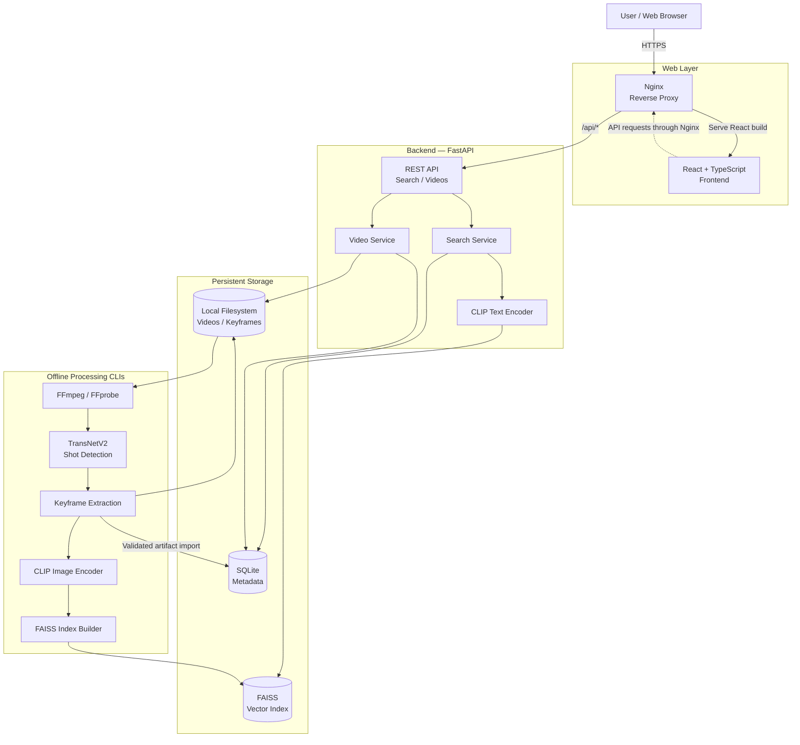

# AI Video Retrieval — System Architecture

The system processes videos into searchable keyframes and lets a user find,
inspect, and play the source footage. The target deployment runs a React
frontend and a FastAPI backend behind Nginx. The existing CLIs run video
processing separately. SQLite stores the video catalog, FAISS stores the
searchable vector index, and the local filesystem stores videos and keyframes.

**Current implementation:** the CLI performs shot detection, keyframe
extraction, CLIP image embedding, and FAISS index construction. Validated JSON
manifests and sidecars remain reproducible metadata sources. M3 adds a SQLite
catalog, Alembic migrations, validated atomic imports, typed queries, and an
import CLI. The web app, API, Nginx configuration, and application Docker
deployment in this document are planned. The existing `docker-compose.yml` only starts a
PostgreSQL/pgvector container; it does not deploy this target architecture.

## 1. Overall system diagram



The CLIP encoders are model components inside their respective Python
processes, not independent network services. Processing runs through the CLIs
outside API requests. The backend reads the index's row mapping alongside FAISS so each result can be
resolved to its source video, keyframe, and timestamp.

## 2. Online video retrieval

1. The browser loads the React app over HTTPS from Nginx. React sends search
   and video requests to `/api/*` on the same origin; Nginx forwards them
   to FastAPI.
2. For a search, FastAPI validates a nonempty query and bounded `top_k`. The
   search service uses the CLIP text encoder matching the image index, then
   searches FAISS for the highest scoring keyframe vectors.
3. The service resolves FAISS rows through the matching row metadata and
   catalog records. It returns ranked keyframes with video name, shot and frame
   references, stored presentation timestamp, score, and media URLs. A score
   expresses similarity, not proof that an object appears.
4. React shows thumbnails and opens the source video at the returned
   timestamp. FastAPI reads approved local media paths and supports HTTP byte
   ranges so the browser can seek. Video listing reads catalog metadata.

The current FAISS index is `IndexFlatIP` over L2-normalized 512-dimensional
CLIP ViT-B/32 image vectors, making inner-product ranking equivalent to cosine
similarity. Load the text model and a validated index/row mapping together at
API startup; report search unavailable when they are missing or incompatible.
The API and React flow above are planned; see
[backend architecture](05_BACKEND_ARCHITECTURE.md) for the proposed routes.

## 3. Offline video processing

1. A video is placed under the configured video root, then an operator runs
   the existing processing CLI.
2. The CLI probes video metadata with FFprobe and decodes source frames
   through PyAV, which uses FFmpeg. TransNetV2 detects shot boundaries, then
   one full-resolution middle keyframe is extracted per shot with its decoded
   presentation timestamp.
3. The CLIP image encoder converts validated keyframes to normalized vectors.
   The index builder combines compatible feature files into a FAISS index and
   publishes its matching row metadata and manifest. The backend loads a new
   published set on restart in the initial design.
4. Source videos and keyframe JPEGs stay on the filesystem. The importer
   copies validated Phase 1 video, shot, and keyframe records into SQLite.
   Phase 2 sidecars remain the source for rebuilding the index. A failed run
   preserves the previous valid artifacts.

The CLI implements processing and indexing. The separate catalog importer
synchronizes completed Phase 1 artifacts into SQLite. Run it after processing:

```bash
uv run alembic upgrade head
uv run python -m backend.app.catalog.cli import --input data_processed/transnetv2
```

See
[video processing](03_VIDEO_PROCESSING.md) and
[feature extraction](04_FEATURE_EXTRACTION.md) for the current artifact and
command contracts.

## 4. Storage boundaries

| Store | Target role | Current state |
| --- | --- | --- |
| SQLite | Video catalog and shot/keyframe lookup | Implemented; synchronized from validated Phase 1 artifacts via the import CLI |
| FAISS | Similarity search over CLIP image vectors | Implemented by the CLI, with a JSON row mapping and index manifest |
| Local filesystem | Source videos, keyframe JPEGs, JSON manifests, feature arrays, and index files | Implemented under `data/` and `data_processed/` |

FAISS row numbers are only meaningful with the exact row metadata published
with that index. Keep stable source video and keyframe identifiers in catalog
records; do not use a FAISS row number as a persistent ID. Preserve stored
presentation timestamps instead of deriving playback time from frame index
and FPS. The implemented SQLite schema and validated artifact import are
specified in [database and FAISS index](06_DATABASE.md). Validated JSON remains
the reproducible import source; SQLite is the queryable catalog after commit.

## 5. Nginx and Docker deployment

The target Docker Compose deployment has an Nginx service and a FastAPI service.
Nginx serves the built React assets and proxies `/api/*` to FastAPI over a
private container network. Configure TLS termination at Nginx or at an
explicitly designated upstream proxy. Run processing CLIs separately.

Mount persistent volumes for source videos, generated keyframes/features,
FAISS index artifacts, and the SQLite database. The API needs read access to
published media, catalog, and index artifacts. Publish a complete index, row
mapping, and manifest together before the API loads them. Keep model weights
available to both encoders and configure the same CLIP checkpoint and
representation in both processes.

The current `docker-compose.yml` defines only a PostgreSQL/pgvector service.
Application images, Nginx routes/TLS configuration, and volumes must be added
before this diagram describes a runnable Docker deployment.
For local development, keep an unauthenticated API on localhost; add access
control before exposing the application remotely.

## 6. Detailed specifications

- [Project brief](01_PROJECT_BRIEF.md): product scope and acceptance criteria.
- [Video processing](03_VIDEO_PROCESSING.md): Phase 1 decoding, shots, timestamps, and reruns.
- [Feature extraction](04_FEATURE_EXTRACTION.md): CLIP configuration and index commands.
- [Backend architecture](05_BACKEND_ARCHITECTURE.md): planned API contracts and media delivery.
- [Database and FAISS index](06_DATABASE.md): implemented SQLite catalog, current index artifacts, validation, and recovery.
- [Implementation checklist](TODOS.md): current progress and remaining work.
