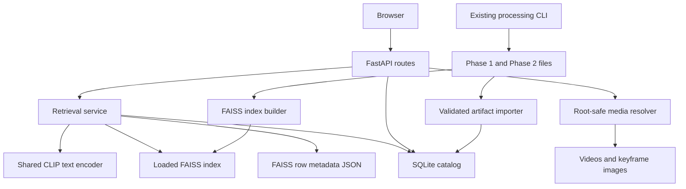

# Backend — SQLite Catalog and Search API Plan

Status: M3 catalog implemented; HTTP API planned. The repository provides
offline Phase 1/2 processing, FAISS index construction, catalog models, SQLite
engine/session setup, pre-write artifact validation, the initial Alembic
migration, atomic import, typed queries, and an import CLI. Retrieval services
and the HTTP API described here remain to be built.

This plan exposes a SQLite catalog imported from validated JSON artifacts to a
local browser. The FAISS index holds searchable vectors, and videos/images stay
on disk.

## 1. Goal and scope

Build a small Python backend that can:

1. Search the built FAISS index with a natural-language query.
2. Return source-linked keyframes, scores, and playback timestamps.
3. List videos and show their imported Phase 1 metadata from SQLite.
4. Serve keyframe images and source videos safely from configured local roots.
5. Call the existing processing/retrieval functions instead of duplicating them.

The first useful web workflow is **query → ranked keyframes → open source video
at timestamp**. Keep processing and index rebuilds as CLI operations.

## 2. Data sources

| Need | Source |
| --- | --- |
| Video identity, technical metadata, and shot/keyframe lookup | SQLite `videos`, `shots`, `keyframes` |
| Feature provenance | Phase 2 JSON sidecars |
| Catalog import source | Validated Phase 1 JSON/keyframes |
| Vector row and keyframe mapping | FAISS `*_metadata.json` |
| Index provenance and compatibility | FAISS `*_index.json` manifest |
| Image/video bytes | Files beneath configured media roots |

Video name is the public video identifier for the local collection. Resolve
its batch and paths from validated records, not from an arbitrary user-supplied
filesystem path. An importer synchronizes completed, validated artifacts into
SQLite. The API reads catalog rows; source JSON remains the reproducible input
for re-import and repair.

The current Phase 1 pipeline keeps one completed result per video, not complete
processing history.

## 3. Components and request flow



Responsibilities:

- **Routes:** validate HTTP requests and format responses/errors.
- **Retrieval service:** encode the query with the matching CLIP model, call
  FAISS, and attach row metadata.
- **Catalog importer:** validate Phase 1 `shots.json` and keyframes; update SQLite in
  per-video transactions.
- **Catalog queries:** read videos, shots, and keyframes from SQLite.
- **Media resolver:** resolve relative artifact/source keys beneath approved
  roots; reject traversal and escaping symlinks.
- **Processing CLI:** remain the entry point for expensive offline work.

Keep retrieval and analysis services callable directly from Python for CLI
use, evaluation, and reuse by API routes.

## 4. Proposed layout

```text
backend/
├── app/
│   ├── main.py
│   ├── config.py
│   ├── database.py                    # implemented engine/session factories
│   ├── models.py
│   ├── catalog/
│   │   ├── validation.py              # implemented pre-write validation
│   │   ├── importer.py                # implemented atomic import
│   │   ├── queries.py                 # implemented typed queries
│   │   └── cli.py                     # implemented import command
│   ├── schemas.py
│   ├── api/
│   │   ├── health.py
│   │   ├── videos.py
│   │   ├── search.py
│   │   └── media.py
│   └── services/
│       ├── retrieval.py
│       └── media.py
└── migrations/                       # Alembic versions
```

Use SQLAlchemy 2.x models and an Alembic migration for the SQLite schema in
[06_DATABASE.md](06_DATABASE.md). Keep route handlers thin with Pydantic
request/response schemas; a repository framework or generic storage plugin is
unnecessary for this local application.

## 5. Search behavior

1. Validate a nonempty query and a bounded `top_k`.
2. Encode text with the same CLIP checkpoint and representation used for image
   embeddings; L2-normalize it.
3. Search the loaded FAISS index with inner product.
4. Resolve each row through the index metadata JSON, verify its video/shot/
   keyframe against SQLite, and return its identifiers, score, timestamp, and
   media URL.

The current index is exact inner-product search over normalized vectors, so its
score is cosine similarity. It is a ranking signal, not proof that an object is
present. Return keyframes (not distinct videos) and preserve the source
presentation timestamp.

Start with unfiltered Top K search. Add batch/video filters only with a clear
behavior for selecting a complete filtered Top K; a simple post-filter of the
global Top K can otherwise return too few results. Optional playlist indexes
can support playlist-scoped search where those indexes exist.

Load the text encoder and a validated FAISS snapshot once during application
startup. If either is missing, incompatible with the index manifest/catalog, or
fails validation, report search readiness as unavailable. Report catalog
readiness separately. Rebuild indexes with the CLI and restart the API after
publication; live index swapping is not needed initially.

## 6. Initial HTTP contracts

Use `/api/v1` for application routes and expose FastAPI OpenAPI docs locally.
Video names are strings, not database UUIDs. Resolve a name-only route only
when that name identifies one batch; otherwise require a batch qualifier.

| Method and route | Purpose |
| --- | --- |
| `GET /health/live` | Process is running |
| `GET /health/ready` | SQLite catalog is available; report search readiness separately for CLIP/index compatibility |
| `GET /api/v1/videos` | Paginated video catalog |
| `GET /api/v1/videos/{video_name}` | Video metadata, counts, and processing settings |
| `GET /api/v1/videos/{video_name}/keyframes` | Keyframes ordered by shot index |
| `POST /api/v1/search` | Natural-language query and bounded top-K results |
| `GET /api/v1/media/keyframes/{video_name}/{name}` | Keyframe JPEG response |
| `GET /api/v1/media/videos/{video_name}` | Source video response with byte-range support |

Use stable pagination ordering for catalog endpoints. Return a controlled 404
for missing records/files, 422 for invalid input, 503 for unavailable search
artifacts, and 500 for unexpected failures. Do not include absolute paths or
stack traces in responses.

## 7. Media and configuration

| Setting | Purpose |
| --- | --- |
| `PROJECT_ROOT` | Resolve project-relative source keys |
| `VIDEO_ROOT` | Allowed downloaded-video directory |
| `PROCESSED_ROOT` | Keyframes, metadata, and feature artifacts |
| `DATABASE_URL` | SQLite catalog under `data_processed/database/` |
| `INDEX_ROOT` | Published FAISS indexes and row metadata |
| `CLIP_MODEL_NAME` | Must match the feature/index manifest |
| `CLIP_DEVICE` | `cpu`, `cuda`, or `auto` |
| `CORS_ORIGINS` | Explicit local frontend origins |
| `LOG_LEVEL` | Application log verbosity |

Resolve paths and verify containment after resolving symlinks. Never accept an
arbitrary server path or URL as a media identifier. Support HTTP byte ranges
for video playback and return the stored playback timestamp to the client.

Keep the unauthenticated API bound to localhost. Add access control before
remote exposure. Local SQLite needs a writable path, not network credentials.

## 8. Processing control

The CLI remains the supported path for processing and index updates:

```bash
uv run python -m data_processing.cli phase1 --batch Videos_L21
uv run python -m data_processing.cli phase2 --batch Videos_L21
uv run python -m data_processing.phase2_feature_extraction.build_index --model clip
```

Run the existing CLIs outside HTTP requests, then synchronize the catalog and
rebuild the index as needed.

## 9. Implementation sequence

| Step | Work | Completion |
| --- | --- | --- |
| 1 — SQLite catalog | Models, migration, validated importer, catalog queries | Implemented and tested (M3 complete) |
| 2 — FAISS retrieval | Snapshot validation, query encoding, row mapping and catalog checks | Query returns ranked keyframes with correct source timestamps |
| 3 — Search API and media | FastAPI routes, validation, health checks, safe byte-range serving | OpenAPI requests return expected result contracts |
| 4 — Browser | React search/results/playback workflow | User can search and inspect source video at result timestamps |

Measure query latency and memory with the actual corpus. A FAISS Flat index
stores vectors in memory; at 512 float32 values per keyframe, the vector data
alone uses about 2 KB per row. Keep exact search while it meets local needs.

## 10. Documentation boundary

| Document | Owns |
| --- | --- |
| [02_ARCHITECTURE.md](02_ARCHITECTURE.md) | Overall component boundaries and milestones |
| [03_VIDEO_PROCESSING.md](03_VIDEO_PROCESSING.md) | Phase 1 metadata and keyframe contracts |
| [04_FEATURE_EXTRACTION.md](04_FEATURE_EXTRACTION.md) | CLIP feature and FAISS index artifacts |
| [06_DATABASE.md](06_DATABASE.md) | SQLite schema, artifact import, FAISS row mapping, and recovery |
