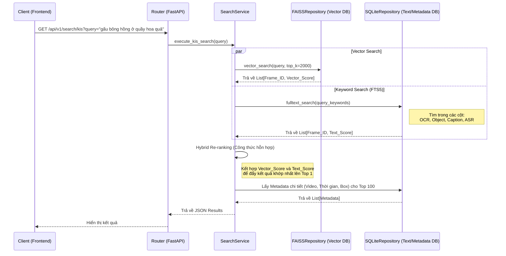

# Kiến trúc Backend Hệ thống Tìm kiếm AIC 2026

Tài liệu này thiết kế kiến trúc Backend tập trung vào tác vụ **Known-Item Search (KIS)**, sử dụng `FastAPI`, `FAISS`, và `SQLite`.

---

## 1. Sơ đồ luồng xử lý (System Architecture & Data Flow)

Dưới đây là sơ đồ luồng xử lý cho tác vụ KIS khi nhận được một câu truy vấn (Text Query):



---

## 2. Kiến trúc Cấu trúc Thư mục (Folder Structure)

Chúng ta tuân thủ mô hình **Layered Architecture** (Phân tầng) cực kỳ chuẩn mực trong hệ thống phần mềm doanh nghiệp:

```text
backend/
├── main.py                  # Điểm khởi chạy của FastAPI ứng dụng
├── core/                    # Cấu hình lõi (Lifespan, config.yaml loader, constants)
│   ├── config.py
│   └── lifespan.py          # Quản lý load AI models và FAISS index 1 lần duy nhất
├── api/                     # Lớp Controller (Router)
│   ├── dependencies.py      # Dependency Injection (cung cấp DB session, Services)
│   └── routes/
│       └── search.py        # Chứa endpoint /api/v1/search/kis
├── services/                # Lớp Business Logic (Xử lý nghiệp vụ)
│   ├── search_service.py    # Giao tiếp với repositories, thực hiện Hybrid Re-ranking
│   └── strategy/            # Chứa các class Strategy cho SigLIP2, BEiT3, DINOv3
├── repositories/            # Lớp Data Access (Giao tiếp với DB)
│   ├── faiss_repo.py        # Thao tác đọc/search trên file .index
│   └── sqlite_repo.py       # Chạy các câu lệnh SQL SELECT/FTS5 trên metadata.db
└── schemas/                 # Lớp Models (Pydantic) định nghĩa Request/Response JSON
    └── search_schema.py     
```

---

## 3. Thiết kế chi tiết các Layer (Ví dụ code mô phỏng)

### 3.1. Layer 1: Cấu trúc Database (SQLite + FAISS)
* **SQLite:** Chúng ta tạo một CSDL có bảng FTS5 gộp (hoặc kết nối).
* **FAISSRepository:** Chỉ chứa các hàm tương tác với FAISS:
  ```python
  class FAISSRepository:
      def __init__(self, index_path, meta_path):
          self.index = faiss.read_index(index_path)
          self.metadata = np.load(meta_path, allow_pickle=True)
          
      def search(self, vector_query: np.ndarray, top_k: int = 2000):
          distances, indices = self.index.search(vector_query, top_k)
          # Trả về danh sách frame_id và score tương ứng
          return [(self.metadata[idx], float(dist)) for dist, idx in zip(distances[0], indices[0]) if idx != -1]
  ```

### 3.2. Layer 2: API Route (Controller)
File `api/routes/search.py`: Endpoint nhận request. Nó không được chứa logic xử lý mảng hay SQL.
```python
from fastapi import APIRouter, Depends
from schemas.search_schema import KISSearchRequest, SearchResponse
from services.search_service import SearchService
from api.dependencies import get_search_service

router = APIRouter()

@router.post("/kis", response_model=SearchResponse)
async def search_known_item(
    request: KISSearchRequest,
    service: SearchService = Depends(get_search_service)
):
    # Ủy quyền toàn bộ xử lý cho Service
    results = service.execute_kis(query=request.text, top_k=request.top_k)
    return {"results": results, "query": request.text}
```

### 3.3. Layer 3: Service (Trái tim của hệ thống)
File `services/search_service.py`: Nơi thực hiện **Hybrid Re-ranking**. Đây là nơi tư duy thuật toán diễn ra.
```python
class SearchService:
    def __init__(self, faiss_repo: FAISSRepository, sqlite_repo: SQLiteRepository, embedding_model):
        self.faiss_repo = faiss_repo
        self.sqlite_repo = sqlite_repo
        self.embedding = embedding_model
        
    def execute_kis(self, query: str, top_k: int):
        # 1. Trích xuất đặc trưng câu truy vấn bằng Model (ví dụ SigLIP2)
        query_vector = self.embedding.encode_text(query)
        
        # 2. Tìm kiếm trên Vector DB (FAISS) lấy Top 2000 ứng viên
        vector_results = self.faiss_repo.search(query_vector, top_k=2000)
        
        # 3. Tìm kiếm từ khóa trên SQLite FTS5 (OCR, Objects, Audio)
        # Giả sử hàm FTS trả về dict {frame_id: fts_score}
        keyword_results = self.sqlite_repo.fulltext_search(query)
        
        # 4. Hợp nhất và chấm điểm lại (Hybrid Re-ranking)
        final_scores = {}
        for frame_id, vec_score in vector_results:
            # Nếu frame_id cũng xuất hiện trong kết quả text search thì cộng thêm điểm ưu tiên
            text_score = keyword_results.get(frame_id, 0.0)
            
            # Công thức chấm điểm (Ví dụ: Cosine similarity càng cao càng tốt)
            # Hệ số w1, w2 được tinh chỉnh qua thực nghiệm
            hybrid_score = (0.7 * vec_score) + (0.3 * text_score)
            final_scores[frame_id] = hybrid_score
            
        # 5. Sắp xếp lại lấy top_k
        top_frames = sorted(final_scores.items(), key=lambda x: x[1], reverse=True)[:top_k]
        
        # 6. Đọc thông tin chi tiết (video tên gì, fps, thời gian...) từ SQLite
        detailed_results = self.sqlite_repo.get_details_by_ids([f[0] for f in top_frames])
        return detailed_results
```

---

## 4. Tóm tắt tại sao thiết kế này mạnh mẽ cho cuộc thi AIC
1. **Linh hoạt thay đổi thuật toán:** Nếu BTC cho một câu hỏi KIS liên quan mạnh đến chữ viết (OCR), bạn chỉ cần điều chỉnh tỷ trọng `0.3 * text_score` trong Service mà không phải sửa DB hay API.
2. **Siêu tốc độ:** FAISS và SQLite đều chạy In-memory hoặc qua C/C++ backend nên độ trễ trả về thường dưới `50ms` dù database có hàng triệu frame.
3. **Dễ test độc lập:** Bạn có thể viết Unit Test cho `FAISSRepository` riêng, và test cho `SearchService` riêng, chia việc cho các thành viên trong team rất dễ.
