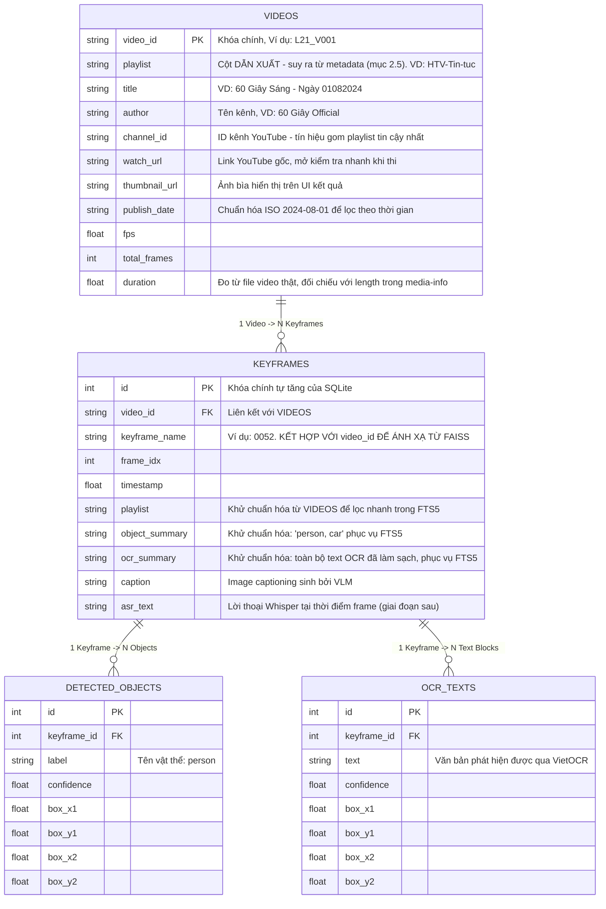

# Database Architecture (Hệ thống Cơ sở dữ liệu)

Hệ thống AIC 2026 sử dụng kiến trúc **Dual-Database** (Cơ sở dữ liệu kép), tận dụng sức mạnh của cả Vector Search và Text/Metadata Search:
1. **Vector Database (FAISS):** Chuyên xử lý các truy vấn tìm kiếm dựa trên độ tương đồng (Similarity Search) thông qua các Vector Embeddings. Hệ thống chịu trách nhiệm cho các model như SigLIP2, BEiT-3, DINOv3.
2. **Relational Database (SQLite):** Đóng vai trò là "Source of Truth" (Nguồn gốc chân lý) lưu trữ metadata (Video, Keyframes, Objects), và phục vụ **Full-Text Search (FTS5)** đối với văn bản nhận diện được (OCR, ASR, Image Captioning).

---

## 1. Cấu trúc Index (Model-based + Playlist-based Indexing)

Hệ thống lập chỉ mục theo 2 tầng: **mỗi model AI có một bộ index riêng**, và trong mỗi model có **1 index global + N index theo playlist** (tách sẵn ở bước offline).

### 1.1. Cấu trúc thư mục vật lý
```text
AIC2026/
└── data/
    ├── metadata.db                       # CSDL SQLite chứa thông tin đối tượng
    ├── features/                         # Embedding trung gian: MỖI VIDEO 1 FILE .npy
    │   ├── siglip2/
    │   │   ├── L21_V001.npy
    │   │   └── L21_V002.npy
    │   └── ...
    └── index/                            # FAISS index thành phẩm (run_embedding.py build)
        ├── siglip2_keyframe_embedding.index   # Index toàn cục (mọi video) của siglip2
        ├── siglip2_keyframe_metadata.npy
        ├── beit3_keyframe_embedding.index
        ├── beit3_keyframe_metadata.npy
        ├── dinov3_keyframe_embedding.index
        ├── dinov3_keyframe_metadata.npy
        └── playlist/                          # Index riêng của từng playlist, đủ mọi model
            ├── siglip2_HTV-Tin-tuc.index
            ├── siglip2_HTV-Tin-tuc_keyframe_metadata.npy
            └── ...
```

### 1.2. Mối quan hệ giữa FAISS Index và Numpy Metadata
Vì mã nguồn sử dụng hàm `index.add(embedding_array)` (thêm vector tuần tự) thay vì `index.add_with_ids()`, các vector trong FAISS sẽ nhận ID ngầm định theo thứ tự nạp vào (`0, 1, 2, ...`)
- Mỗi file `.index` chứa không gian vector sử dụng chuẩn đo **L2 Distance** (`faiss.IndexFlatL2`).
- Mỗi file `.index` có một file `_metadata.npy` **song hành riêng của nó** (vì thứ tự vector trong index global khác với trong index playlist). Phần tử ở vị trí thứ `i` của mảng Numpy lưu Tuple `(video_id, keyframe_name)` (Ví dụ: `("L21_V001", "0052")`).
- **Khi tìm kiếm:** FAISS trả về ID `150`. Hệ thống truy cập vào mảng Numpy (của đúng index đang search) ở vị trí 150 để lấy ra cặp `("L21_V001", "0052")`, sau đó dùng cặp thông tin này để Query vào SQLite lấy dữ liệu chi tiết.

### 1.3. Lọc theo Playlist: Tách Index ở bước Offline

**Thiết kế đã chốt:** mỗi video được encode thành một file `.npy` riêng (VD `L21_V001.npy`). Khi BTC công bố metadata (`media-info/*.json`), ta suy ra playlist cho từng video (quy trình ở mục 2.5) rồi gom nhóm và build index — cả hai tầng đều do `run_embedding.py` đảm nhiệm (encode có cache: video đã có `.npy` thì skip):

```text
per-video .npy ──(metadata BTC: video -> playlist)──> gom nhóm ──> build index:
  ├── index/siglip2_keyframe_embedding.index   (global: concatenate TẤT CẢ video)
  ├── index/playlist/siglip2_HTV-Tin-tuc.index (concatenate các video thuộc playlist)
  └── ...                            (mỗi index kèm 1 file metadata .npy song hành)
```

Ưu điểm của thiết kế này:
- Kiến trúc per-video `.npy` làm cho việc build index theo bất kỳ cách gom nhóm nào (playlist, thể loại, vòng thi...) chỉ là một phép concatenate — **không bao giờ phải chạy lại model encode**.
- Search trong playlist chỉ quét đúng số vector của playlist đó: playlist chiếm 5% dữ liệu → chỉ tốn ~5% thời gian quét so với index global.
- Khớp với chiến lược "Category/Playlist Encoding" trong `competition_info.md`.

> **Ghi chú kỹ thuật (để hiểu đúng trade-off):** phương án thay thế `IDSelectorBatch` không nạp thêm bản sao index vào RAM — nó lọc ngay trên index global sẵn có, phần tốn thêm chỉ là mảng ID (vài MB). Lợi ích thực sự của việc tách index offline không phải là tiết kiệm RAM mà là **tốc độ quét** (chỉ scan vector của playlist) và sự độc lập của từng file index. `IDSelectorBatch` vẫn được dùng trong hệ thống, nhưng cho mục đích khác: lọc cứng OCR/Object *bên trong* index đã chọn (xem mục 5.2).

### 1.4. Chiến lược nạp Index vào RAM (Preload vs Lazy-load)

Câu hỏi: nạp hết index playlist ngay lúc startup, hay đợi user chọn playlist mới nạp rồi cache có TTL?

Điểm mấu chốt để quyết định: **tổng dung lượng các index playlist cộng lại = đúng bằng index global** (vì các playlist chia nhau tập video, không trùng lặp). Nghĩa là preload toàn bộ playlist index chỉ **nhân đôi** RAM phần vector chứ không nhân N lần.

Công thức ước lượng nhanh:
```text
RAM ≈ số_keyframe × số_chiều × 4 bytes × 2 (global + tổng playlist) × số_model_đang_bật
VD:   500.000 keyframe × 1536 chiều (SigLIP2) × 4B ≈ 2.9 GB → cả 2 tầng ≈ 5.8 GB / model
```

Số đo thực tế trên batch b1 (150.242 keyframe): SigLIP2 dim **1536** → index global 923 MB;
DINOv3 dim **1280** → 769 MB. Preload cả 2 tầng của cả 2 model ≈ **3,4 GB**.

| | **Preload tất cả lúc startup** (KHUYẾN NGHỊ nếu đủ RAM) | Lazy-load + TTL cache tự viết | Memory-map (`mmap`) |
|---|---|---|---|
| Độ trễ query đầu tiên | **0** | Cao: đọc file index hàng trăm MB từ đĩa mất vài giây — rất nguy hiểm khi đang thi tính giờ | Thấp–vừa (OS nạp dần theo trang khi search chạm tới) |
| RAM | Cao nhất (×2 mỗi model) | Thấp | OS tự quản lý, tự thu hồi phần lâu không dùng |
| Độ phức tạp code | Không có | Phải viết cache + hết hạn TTL + lock chống 2 request cùng nạp 1 index | Chỉ thêm 1 flag khi `read_index` |

**Khuyến nghị theo thứ tự:**
1. **Nếu tổng ước lượng < ~50–60% RAM máy chủ → preload tất cả lúc startup.** Đơn giản nhất, độ trễ ổn định tuyệt đối giữa trận thi. Startup chậm thêm vài chục giây không quan trọng.
2. **Nếu RAM căng → dùng mmap thay vì tự viết TTL cache:** `faiss.read_index(path, faiss.IO_FLAG_MMAP)`. OS tự nạp phần index được chạm tới và tự "xóa khỏi RAM" phần lâu không dùng — đây chính xác là hành vi "nạp khi cần + tự giải phóng sau một thời gian không sử dụng" mà bạn muốn, nhưng có sẵn miễn phí, không phải code, không có bug hết-hạn-cache.
3. TTL cache tự viết là lựa chọn cuối cùng — nó tái tạo lại thứ OS đã làm tốt hơn, và rủi ro (stall ở query đầu tiên vào playlist lạnh) rơi đúng vào lúc thi.

---

## 2. Relational Database (SQLite)

Dưới đây là sơ đồ cấu trúc của cơ sở dữ liệu quan hệ (được định nghĩa qua file `models.py`).

### 2.1. Sơ đồ thực thể liên kết (Relational ER Diagram)



### 2.2. Điểm cốt lõi trong Schema:
1. **Mapping FAISS -> SQLite qua cặp Composite Key (`video_id`, `keyframe_name`):** Vì FAISS Index trong mã nguồn hiện tại không lưu trữ khóa chính của cơ sở dữ liệu SQLite, việc liên kết 2 bên bắt buộc phải đi qua cầu nối là mảng Numpy (`.npy`). Từ `FAISS ID` -> `Numpy Index` -> `(video_id, keyframe_name)` -> `SELECT * FROM keyframes WHERE video_id=? AND keyframe_name=?`.
2. **Khử chuẩn hóa (Denormalization):** FTS5 của SQLite search chữ rất nhanh trên 1 bảng. Để tránh phải JOIN quá nhiều, các trường `object_summary`, `ocr_summary` và `caption` được nối chuỗi và dán thẳng vào bảng `KEYFRAMES`. Ta sẽ tạo một bảng ảo `keyframes_fts` (Virtual Table FTS5) đồng bộ với bảng này để search bằng từ khóa (giải thích chi tiết ở mục 2.3).
3. **OCR có 2 nơi lưu với 2 mục đích khác nhau:** Bảng `OCR_TEXTS` giữ từng dòng chữ kèm Bounding Box (phục vụ vẽ khung highlight trên UI); còn `keyframes.ocr_summary` là toàn bộ chữ trên frame đã được làm sạch (lowercase, bỏ ký tự rác — xem `data_processing.md`) để FTS5 lập chỉ mục. **Nếu không có cột này thì FTS5 không search được OCR.**
4. **Cột `playlist` được khử chuẩn hóa xuống `KEYFRAMES`:** để câu query FTS5 có thể lọc `WHERE playlist = ?` trực tiếp, không cần JOIN với `VIDEOS`.

### 2.3. FTS5 là gì? Tại sao phải tạo bảng ảo `keyframes_fts`?

**Vấn đề với cách search chữ thông thường (`LIKE`):** Câu lệnh `SELECT ... WHERE caption LIKE '%cảnh sát%'` bắt SQLite đọc **toàn bộ bảng** và so từng chuỗi một (full table scan). Index thường (B-Tree) hoàn toàn vô dụng với mẫu `%...%` vì B-Tree chỉ tra cứu được theo *tiền tố*. Với 500.000 dòng caption/OCR, mỗi lần gõ query sẽ mất hàng trăm ms đến vài giây, và cũng không có cách nào xếp hạng "dòng nào liên quan hơn".

**FTS5 = Inverted Index (chỉ mục ngược):** FTS5 là module có sẵn của SQLite. Nó tách văn bản thành các token (từ), rồi xây một "mục lục tra ngược": *từ → danh sách các dòng chứa từ đó*.

```text
Bảng keyframes (dữ liệu gốc):           Inverted index mà FTS5 xây:
rowid=1: "cảnh sát giao thông"           "cảnh"  -> [1, 3]
rowid=2: "em bé chơi bóng"               "sát"   -> [1, 3]
rowid=3: "xe cảnh sát trên phố"          "giao"  -> [1]
                                         "bóng"  -> [2]
```

Search `"cảnh sát"` = tra 2 danh sách rồi lấy phần giao → ra `[1, 3]` gần như tức thì (không đụng đến các dòng khác), kèm điểm **BM25** để xếp hạng độ liên quan.

**"Bảng ảo" (Virtual Table) nghĩa là gì:** `keyframes_fts` *trông và query như một bảng bình thường* (SELECT/INSERT được), nhưng bên dưới nó không lưu dữ liệu dạng dòng-cột thông thường mà lưu cấu trúc inverted index ở trên. "Ảo" = giao diện là bảng, ruột là chỉ mục.

**Tại sao không bật FTS5 thẳng lên bảng `keyframes`?** Vì FTS5 là một kiểu lưu trữ (storage engine) riêng — một bảng SQLite thường không thể "gắn thêm" khả năng full-text. Mô hình chuẩn là: bảng thường giữ dữ liệu gốc (source of truth), bảng ảo FTS5 đứng **cạnh** nó làm mục lục. Hai tùy chọn trong lệnh CREATE (xem Bước 3, mục 6) nghĩa là:
- `content='keyframes', content_rowid='id'` → khai báo đây là **external content table**: FTS5 *không copy lại* văn bản gốc, chỉ lưu phần chỉ mục và trỏ ngược về bảng `keyframes` qua `rowid`. Tiết kiệm khoảng một nửa dung lượng.
- Cái giá phải trả: FTS5 không tự biết khi nào bảng gốc thay đổi → bắt buộc có **Trigger** `AFTER INSERT/UPDATE/DELETE` để đồng bộ 2 bên.
- Các cột `UNINDEXED` (`video_id`, `keyframe_name`, `playlist`) = "mang theo để đọc ra và lọc WHERE, nhưng đừng tách từ/lập chỉ mục" — không ai cần full-text search trên mã video, và index nhờ vậy nhỏ hơn.

**Cách query:**
```sql
-- Tìm keyframe có chữ "cảnh sát" trong BẤT KỲ cột nào được index (caption, ocr_summary...):
SELECT video_id, keyframe_name FROM keyframes_fts WHERE keyframes_fts MATCH 'cảnh sát';

-- Giới hạn trong 1 cột + xếp hạng theo độ liên quan (bm25 càng nhỏ = càng liên quan):
SELECT video_id, keyframe_name, bm25(keyframes_fts) AS score
FROM keyframes_fts
WHERE keyframes_fts MATCH 'ocr_summary: "chứng khoán"'
ORDER BY score LIMIT 100;
```

**Lưu ý cho tiếng Việt:** tokenizer mặc định `unicode61` tách từ theo khoảng trắng và xử lý Unicode đúng, nên tiếng Việt có dấu hoạt động ổn ở mức khớp-đúng-từ. Có thể cân nhắc `tokenize = "unicode61 remove_diacritics 2"` để gõ không dấu (`canh sat`) vẫn khớp có dấu (`cảnh sát`) — đánh máy nhanh hơn khi thi, đổi lại chấp nhận một ít kết quả nhiễu (má/ma/mã bị coi là một).

### 2.4. Có nên tạo Enum cho Playlist không?

**Không nên.** Quy tắc chung: *Enum dành cho giá trị cố định trong code; playlist là DỮ LIỆU.*
- Danh sách playlist chỉ biết được khi BTC công bố metadata, và có thể thay đổi/bổ sung giữa các vòng thi. Hard-code Enum nghĩa là mỗi lần BTC đổi, bạn phải sửa code và deploy lại.
- Nguồn chân lý đã có sẵn ở 2 nơi khớp nhau: cột `videos.playlist` trong SQLite và các file index trên đĩa (`index/playlist/siglip2_HTV-Tin-tuc.index`). Backend lúc startup chỉ cần quét thư mục index (hoặc `SELECT DISTINCT playlist FROM videos`) để dựng **registry động** `dict[playlist_name -> FAISS index]`.
- Validate request bằng registry đó: `req.playlist not in registry` → trả `400` kèm danh sách playlist hợp lệ. Thêm endpoint `GET /api/playlists` để UI đổ dropdown — user không bao giờ gõ tay sai tên.

**Ngược lại, trường `models` NÊN là Enum** (`siglip2 | beit3 | dinov3`): danh sách model gắn chặt với code (mỗi model cần encoder được cài đặt sẵn trong backend), thêm model mới bắt buộc sửa code — đúng bản chất của Enum.

```python
from enum import StrEnum
from pydantic import BaseModel

class ModelName(StrEnum):          # Enum: tập giá trị cố định trong code
    SIGLIP2 = "siglip2"
    BEIT3 = "beit3"
    DINOV3 = "dinov3"

class KISRequest(BaseModel):
    text_query: str
    models: list[ModelName] = [ModelName.SIGLIP2]
    playlist: str | None = None    # String thường: validate ĐỘNG qua registry, không Enum
    topk: int = 100
```

### 2.5. Metadata từ BTC (`media-info/*.json`) và cách suy ra Playlist

Mỗi video có 1 file JSON metadata do BTC cung cấp (VD `media-info/L21_V001.json`) — thực chất là metadata YouTube của video gốc. Bảng ánh xạ field JSON → cột trong bảng `VIDEOS`:

| Field trong JSON | Cột `VIDEOS` | Ghi chú |
|---|---|---|
| `title` | `title` | Hiển thị trên UI kết quả tìm kiếm |
| `author` | `author` | Tên kênh, dễ đọc cho người (VD "60 Giây Official") |
| `channel_id` | `channel_id` | **Tín hiệu gom playlist tin cậy nhất** — tên kênh có thể đổi, ID thì không |
| `watch_url` | `watch_url` | Mở video gốc trên YouTube để kiểm tra nhanh khi thi |
| `thumbnail_url` | `thumbnail_url` | Ảnh bìa cho danh sách kết quả |
| `publish_date` | `publish_date` | **Chuẩn hóa `01/08/2024` (DD/MM/YYYY) → `2024-08-01` (ISO)** để so sánh/lọc được — KISC hay hỏi kiểu "video tuần trước" |
| `length` | — | Không cần cột riêng: chỉ dùng đối chiếu với `duration` đo từ file thật để phát hiện video tải lỗi |
| `channel_url` | — | Suy ra được từ `channel_id`, không cần lưu |

**Nguyên tắc quan trọng:** `playlist` KHÔNG có sẵn trong JSON — nó là **cột dẫn xuất (derived)**. Vì vậy phải lưu đủ tín hiệu gốc (`channel_id`, `author`, `title`) vào DB, để khi BTC bổ sung batch mới hoặc muốn chia lại playlist, chỉ cần chạy lại bước gán nhãn — không phải parse lại đống JSON.

**Quy trình suy ra playlist (offline, chạy 1 lần mỗi batch dữ liệu):**

1. **Khảo sát:** quét toàn bộ `media-info/*.json`, thống kê tiền tố `video_id` (L21, L22...) × `channel_id`. Kết quả khảo sát thực tế trên batch `media-info-aic25-b1` (873 video): **mỗi batch Lxx là đúng 1 kênh duy nhất**, và một kênh có thể trải nhiều batch:

   | Kênh (`author`) | Batch | Số video | Playlist gợi ý |
   |---|---|---|---|
   | 60 Giây Official | L21, L22 | 60 | `HTV-Tin-tuc` |
   | HTV Sports | L23, L24 | 68 | `HTV-The-thao` |
   | Báo Thanh Niên | L25 | 88 | `On-Thi-THPT` (tên kênh gây hiểu lầm — đọc metadata thì 88/88 video là bài giảng ôn thi THPT, minh chứng cho việc phải phân loại theo NỘI DUNG chứ không theo kênh/folder) |
   | ViVU TV | L26 | 498 | `ViVU-Du-lich` |
   | HTV Giải Trí / HTV Entertainment | L27, L28, L29 | 63 | `HTV-Giai-tri` |
   | Báo Tuổi Trẻ | L30 | 96 | `Tuoi-Tre` |

2. **Gán nhãn theo kênh:** vì Lxx ↔ kênh là 1-1, playlist = tên đặt tay cho từng `channel_id`, quản lý bằng 1 file mapping nhỏ `playlist_mapping.json` (`channel_id -> "HTV-Tin-tuc"`) chỉ vài chục dòng, ai cũng đọc-sửa được. Đây chính là "playlist là dữ liệu" như kết luận ở mục 2.4. **Gom theo `channel_id` chứ không theo tiền tố Lxx** — nhờ vậy L21 và L22 tự động về chung một playlist, và batch tương lai của cùng kênh cũng tự về đúng chỗ.
3. **Nếu sau này 1 kênh trộn nhiều thể loại (hoặc muốn chia mịn hơn):** bổ sung luật keyword trên `keywords`/`title` (VD `"tin tức|60 giây|thời sự" -> Tin-tuc`, `"nấu ăn|món ngon" -> Nau-an`). Keywords của BTC thường rất lộ nghĩa nên luật đơn giản là đủ.
4. **Phần còn sót (long tail):** vài video không khớp luật nào → gán tay, hoặc đưa `title + keywords + description` cho một LLM phân loại zero-shot rồi người duyệt lại. Không nên phức tạp hóa — mục tiêu là ~chục playlist đúng, không phải một classifier hoàn hảo.
5. **Đầu ra:** ghi cột `videos.playlist` (khử chuẩn hóa xuống `keyframes.playlist`), rồi build các index playlist như mục 1.3.

*Tuỳ chọn 2 tầng nhãn:* nếu muốn vừa lọc thô vừa lọc mịn, thêm cột `category` (thể loại lớn: `Tin-tuc` / `The-thao` / `Giai-tri`...) bên cạnh `playlist` (mịn theo kênh). Index FAISS chỉ tách theo `playlist`; `category` chỉ cần là điều kiện lọc trong SQLite, không cần index riêng.

---

## 3. Quản lý Code với Repository Pattern

Để logic Backend sạch sẽ, chúng ta tạo 2 Class Repository chuyên giao tiếp với DB.

### 3.1. FAISS Repository (Mỗi model 1 repo, quản lý global + các playlist index)
```python
# backend/repositories/faiss_repo.py
import os
import faiss
import numpy as np

class FAISSRepository:
    """Quản lý toàn bộ index của MỘT model: 1 index global + N index playlist."""

    def __init__(self, model_name: str, index_dir: str, use_mmap: bool = False):
        """index_dir là thư mục index CHUNG (data_processed/index/), layout do run_embedding.py ghi:
        - global:   {index_dir}/{model}_keyframe_embedding.index (+ _metadata.npy)
        - playlist: {index_dir}/playlist/{model}_{playlist}.index
                    (+ {model}_{playlist}_keyframe_metadata.npy)
        """
        self.model_name = model_name
        self.indexes = {}    # scope -> faiss.Index    (scope = "global" | tên playlist)
        self.metadata = {}   # scope -> mảng numpy các tuple (video_id, keyframe_name)
        self.pos = {}        # scope -> {(video_id, kf_name): faiss_id}, phục vụ lọc cứng

        io_flag = faiss.IO_FLAG_MMAP if use_mmap else 0

        def _load(scope, index_path, meta_path):
            self.indexes[scope] = faiss.read_index(index_path, io_flag)
            meta = np.load(meta_path, allow_pickle=True)
            self.metadata[scope] = meta
            self.pos[scope] = {(v, k): i for i, (v, k) in enumerate(meta)}

        _load("global",
              os.path.join(index_dir, f"{model_name}_keyframe_embedding.index"),
              os.path.join(index_dir, f"{model_name}_keyframe_metadata.npy"))

        playlist_dir = os.path.join(index_dir, "playlist")
        prefix = f"{model_name}_"                          # chỉ nhặt file của đúng model này
        for fname in sorted(os.listdir(playlist_dir)):
            if not (fname.startswith(prefix) and fname.endswith(".index")):
                continue
            playlist = fname[len(prefix): -len(".index")]  # "HTV-Tin-tuc" | ...
            _load(playlist,
                  os.path.join(playlist_dir, fname),
                  os.path.join(playlist_dir, f"{prefix}{playlist}_keyframe_metadata.npy"))

    @property
    def playlists(self) -> list[str]:
        """Registry động: dùng cho validate request + endpoint GET /api/playlists."""
        return [s for s in self.indexes if s != "global"]

    def search(self, query_vector: np.ndarray, top_k: int = 100,
               playlist: str | None = None, allowed_pairs: set | None = None):
        """
        L2 distance CÀNG NHỎ CÀNG TỐT.
        - playlist=None  -> search trên index global; ngược lại search index của playlist đó.
        - allowed_pairs: tập (video_id, kf_name) từ lọc cứng OCR/Object (mục 5.2),
          được đổi sang FAISS id CỦA ĐÚNG index đang search rồi đưa vào IDSelector.
        """
        scope = playlist or "global"
        index, meta = self.indexes[scope], self.metadata[scope]

        if allowed_pairs is not None:
            ids = np.array([self.pos[scope][p] for p in allowed_pairs if p in self.pos[scope]],
                           dtype="int64")
            params = faiss.SearchParameters(sel=faiss.IDSelectorBatch(ids))
            distances, ids_out = index.search(query_vector, top_k, params=params)
        else:
            distances, ids_out = index.search(query_vector, top_k)

        results = []
        for dist, f_id in zip(distances[0], ids_out[0]):
            if f_id != -1:
                video_id, kf_name = meta[f_id]
                results.append((video_id, kf_name, float(dist)))
        return results
```

Khởi tạo lúc startup (theo chiến lược preload ở mục 1.4):
```python
# backend/core/lifespan.py
MODELS = ["siglip2", "beit3", "dinov3"]
faiss_repos = {m: FAISSRepository(m, "data_processed/index") for m in MODELS}
```

### 3.2. SQLite Repository
```python
# backend/repositories/sqlite_repo.py
from sqlalchemy.orm import Session
from sqlalchemy import text, or_
from backend.database.models import Keyframe, Video

class SQLiteRepository:
    def __init__(self, db_session: Session):
        self.db = db_session

    def get_keyframe_details_by_composite(self, video_keyframe_pairs: list[tuple]):
        """
        Nhận vào mảng các cặp (video_id, keyframe_name) từ kết quả của FAISSRepository.
        Tra cứu lấy chi tiết thông tin từ SQLite.
        """
        conditions = [
            (Keyframe.video_id == v) & (Keyframe.keyframe_name == k)
            for v, k in video_keyframe_pairs
        ]
        frames = self.db.query(Keyframe).filter(or_(*conditions)).all()
        return frames

    def search_fts(self, keywords: str, playlist: str | None = None,
                   columns: str | None = None, limit: int = 300):
        """
        Full-text search FTS5 trên caption / object_summary / ocr_summary / asr_text.
        - keywords: PHẢI được làm sạch trước (bỏ dấu câu, escape dấu nháy kép),
          vì cú pháp MATCH của FTS5 sẽ báo lỗi với câu văn thô.
        - columns: giới hạn cột, VD 'ocr_summary' -> MATCH 'ocr_summary:...'
        - Sắp theo bm25() (giá trị càng nhỏ = càng liên quan).
        """
        match_expr = f"{columns}:{keywords}" if columns else keywords
        sql = """
            SELECT video_id, keyframe_name, bm25(keyframes_fts) AS score
            FROM keyframes_fts
            WHERE keyframes_fts MATCH :kw
        """
        params = {"kw": match_expr, "limit": limit}
        if playlist:
            sql += " AND playlist = :playlist"
            params["playlist"] = playlist
        sql += " ORDER BY score LIMIT :limit"

        rows = self.db.execute(text(sql), params).fetchall()
        return [(r[0], r[1], float(r[2])) for r in rows]

    def filter_keyframes_by_objects(self, labels: list[str],
                                    playlist: str | None = None) -> list[tuple]:
        """
        Lọc cứng: trả về các (video_id, keyframe_name) chứa ĐỦ TẤT CẢ nhãn vật thể.
        Dùng GROUP BY + HAVING COUNT(DISTINCT label) = số nhãn yêu cầu.
        """
        sql = """
            SELECT k.video_id, k.keyframe_name
            FROM keyframes k
            JOIN detected_objects o ON o.keyframe_id = k.id
            WHERE o.label IN :labels
              AND (:playlist IS NULL OR k.playlist = :playlist)
            GROUP BY k.id
            HAVING COUNT(DISTINCT o.label) = :n
        """
        rows = self.db.execute(
            text(sql), {"labels": tuple(labels), "playlist": playlist, "n": len(labels)}
        ).fetchall()
        return [(r[0], r[1]) for r in rows]
```

### 3.3. Tổ hợp tại lớp Service
Luồng phối hợp đầy đủ giữa FAISS và SQLite (bao gồm cách hợp nhất kết quả Vector đa model + Object + OCR) được mô tả chi tiết ở **Mục 5 — Hybrid Search**.

---

## 4. API Tìm kiếm KIS (Request / Response Schema)

### 4.1. Request Body
```jsonc
POST /api/search/kis
{
  "text_query": "người phụ nữ áo đỏ cầm cốc nước đứng cạnh xe đạp xanh",  // BẮT BUỘC
  "playlist": "HTV-Tin-tuc",     // TÙY CHỌN — chỉ search trong playlist này
  "topk": 100,                   // TÙY CHỌN — mặc định 100

  // ----- Các trường gợi ý thêm -----
  "models": ["siglip2", "beit3"],  // list Enum; >1 phần tử -> tự động ensemble bằng RRF
  "ocr_query": "chứng khoán",    // Chữ user CHẮC CHẮN thấy trên màn hình
  "object_filters": ["person", "bicycle"],  // Nhãn vật thể bắt buộc có trong frame
  "fusion_weights": { "visual_siglip2": 1.0, "visual_beit3": 0.8, "caption": 0.6, "ocr": 0.8 },
  "exclude_videos": ["L21_V003"],
  "translate_query": true
}
```

| Trường | Kiểu | Bắt buộc | Ý nghĩa & Lý do nên có |
|---|---|---|---|
| `text_query` | string | ✅ | Mô tả phân cảnh. Dùng để (a) encode thành vector cho FAISS, (b) trích keyword cho kênh FTS5 caption. |
| `playlist` | string | ❌ | Giới hạn phạm vi tìm kiếm. Phía FAISS: chọn đúng file index của playlist (mục 1.3). Phía FTS5: `WHERE playlist = ?`. Validate động qua registry (mục 2.4), KHÔNG dùng Enum. |
| `topk` | int | ❌ (mặc định 100) | Số kết quả trả về **sau khi hợp nhất**. Bên trong, mỗi kênh nên lấy dư (`topk × 3`) để phép trộn RRF có không gian hoạt động. |
| `models` | ModelName[] (Enum) | ❌ (mặc định `["siglip2"]`) | Danh sách model embedding. **1 phần tử** = search 1 index như bình thường; **>1 phần tử** = mỗi model trở thành một kênh `visual_<model>` riêng và **tự động kích hoạt trộn RRF** (mục 5.3). Nút "Tất cả" trên UI chỉ đơn giản gửi đủ 3 model — không cần giá trị đặc biệt `"ensemble"`. |
| `ocr_query` | string | ❌ | Tách riêng khỏi `text_query` vì đây là tín hiệu "cứng": nếu user gõ *"chứng khoán"* vào ô OCR nghĩa là chữ đó chắc chắn hiện trên màn hình. Backend không phải đoán từ nào trong câu mô tả là chữ-trên-hình. Các đội mạnh ở VBS/LSC đều tách ô nhập semantic / OCR / object trên UI. |
| `object_filters` | string[] | ❌ | Danh sách nhãn vật thể bắt buộc xuất hiện (lọc cứng qua bảng `DETECTED_OBJECTS`). |
| `fusion_weights` | object | ❌ | Trọng số từng kênh khi trộn RRF (mục 5.2), key theo tên kênh: `visual_siglip2`, `caption`, `ocr`... Cho phép người thi chỉnh nhanh khi thấy một kênh đang nhiễu. |
| `exclude_videos` | string[] | ❌ | Loại các video đã kiểm tra và xác nhận sai — rất hữu ích khi thi KIS tương tác nhiều lượt (nộp sai rồi tìm lại). |
| `translate_query` | bool | ❌ | Dịch câu tiếng Việt → tiếng Anh trước khi encode. Text encoder của SigLIP2/BEiT-3 mạnh tiếng Anh hơn hẳn tiếng Việt; đây là "mẹo" quan trọng với đề thi tiếng Việt. |

### 4.2. Response Body
```jsonc
{
  "results": [
    {
      "video_id": "L21_V001",
      "keyframe_name": "0052",
      "frame_idx": 1560,          // KIS yêu cầu nộp đúng frame index trong khoảng GT
      "timestamp": 62.4,
      "score": 0.0321,            // Điểm RRF sau hợp nhất
      "matched_channels": ["visual_siglip2", "ocr"]   // Frame này được kênh nào bầu chọn
    }
  ]
}
```
`matched_channels` giúp UI giải thích *vì sao* frame được xếp hạng cao (VD: tô viền cam nếu match OCR) — người thi sẽ tin tưởng/loại bỏ kết quả nhanh hơn.

---

## 5. Hybrid Search: Kết hợp Vector Search (đa model) + Object + OCR

### 5.1. Vấn đề: các kênh cho ra các loại điểm không so sánh được

| Kênh | Nguồn | Thang điểm |
|---|---|---|
| Semantic (FAISS, mỗi model 1 kênh) | Vector embedding | L2 distance, `0 → ∞`, **nhỏ = tốt**; và mỗi model có phân phối distance khác nhau |
| Caption / Object (FTS5) | `caption`, `object_summary` | BM25, thang hoàn toàn khác, nhỏ = tốt |
| OCR (FTS5) | `ocr_summary` | BM25 |
| Object filter (SQL) | `DETECTED_OBJECTS` | Chỉ có/không + confidence |

Vì vậy **tuyệt đối không cộng trực tiếp hay min-max normalize điểm số giữa các kênh** — phân phối điểm thay đổi theo từng query nên phép chuẩn hóa rất mất ổn định (điều này đúng cả giữa 2 model embedding khác nhau). Thay vào đó, ta kết hợp theo **2 chế độ** dưới đây, chọn chế độ dựa trên việc user cung cấp tín hiệu gì.

### 5.2. Hai chế độ kết hợp

**Chế độ 1 — Lọc cứng (Filter-then-Rank):** dùng khi user cung cấp tín hiệu chắc chắn (`ocr_query`, `object_filters`).

> Nguyên tắc: **Playlist chọn INDEX, OCR/Object quyết định TẬP ỨNG VIÊN, Vector quyết định THỨ TỰ.**

1. `playlist` (nếu có) quyết định file index nào được search (mục 1.3) — không cần selector.
2. Query SQLite trước để lấy tập `(video_id, keyframe_name)` thỏa điều kiện cứng (có chữ X trên màn hình, có đủ vật thể Y).
3. Đổi tập này sang FAISS id **của đúng index đang search** qua map `pos[scope]` (mục 3.1), đưa vào `IDSelectorBatch` → FAISS chỉ xếp hạng ngữ nghĩa **bên trong** tập ứng viên.
4. *Phòng hờ:* nếu tập ứng viên quá nhỏ (< `topk`), tự động nới lỏng — bỏ lọc cứng, chuyển OCR/Object xuống làm kênh mềm ở chế độ 2, và đánh dấu `"relaxed": true` trong response để UI hiển thị cảnh báo.

**Chế độ 2 — Trộn mềm bằng RRF (Reciprocal Rank Fusion):** dùng khi chỉ có `text_query` tự do, khi user chọn nhiều model, hoặc cho các tín hiệu không đủ chắc để lọc cứng.

Chạy song song các kênh, mỗi kênh trả về một danh sách **đã xếp hạng**, rồi trộn bằng công thức chỉ dựa trên **thứ hạng** (rank), không dùng điểm thô:

$$score(d) = \sum_{c \in channels} \frac{w_c}{k + rank_c(d)} \quad (k = 60)$$

- Frame xuất hiện ở **nhiều kênh** tự động được đẩy lên đầu — đây chính là hành vi ta muốn: "được cả SigLIP2 lẫn BEiT-3 đồng thuận, lại khớp chữ OCR" đáng tin hơn hẳn chỉ khớp một kênh.
- Không cần chuẩn hóa điểm, gần như không cần tuning (`k = 60` là giá trị chuẩn). Đây cũng chính là công thức Elasticsearch/OpenSearch dùng cho hybrid search.
- `w_c` lấy từ `fusion_weights` của request, mặc định `1.0`.

### 5.3. Luồng xử lý đầy đủ tại Service (hỗ trợ nhiều model)

Trả lời câu hỏi *"chọn nhiều model thì có kích hoạt RRF không?"* — **Có, và không cần code riêng cho ensemble.** Hàm `rrf_merge` trộn *mọi* kênh có mặt trong dict `channels`; mỗi model được đưa vào như một kênh `visual_<model>` độc lập:
- Chọn **1 model** → chỉ có 1 kênh visual, RRF trộn nó với các kênh chữ (caption/OCR) như bình thường.
- Chọn **nhiều model / tất cả** → nhiều kênh visual cùng tham gia bầu chọn; "Tất cả" chỉ là trường hợp đặc biệt khi list đủ 3 phần tử.

```python
# backend/services/search_service.py (phác thảo)
K_RRF = 60

def rrf_merge(channels: dict, weights: dict | None = None):
    """channels: {"visual_siglip2": [(video_id, kf_name, raw_score), ...], "caption": [...], ...}
    Trả về [((video_id, kf_name), fused_score, matched_channels)] giảm dần."""
    weights = weights or {}
    fused, hit_by = {}, {}
    for name, results in channels.items():
        w = weights.get(name, 1.0)
        for rank, item in enumerate(results):
            key = (item[0], item[1])
            fused[key] = fused.get(key, 0.0) + w / (K_RRF + rank + 1)
            hit_by.setdefault(key, []).append(name)
    ranked = sorted(fused.items(), key=lambda x: x[1], reverse=True)
    return [(key, score, hit_by[key]) for key, score in ranked]


def search_kis(req: KISRequest):
    # --- 1. Chuẩn bị ---
    query = translate_vi2en(req.text_query) if req.translate_query else req.text_query
    models = req.models or [ModelName.SIGLIP2]   # UI chọn "Tất cả" -> gửi đủ 3 model

    # --- 2. Chế độ 1: dựng tập ứng viên nếu có tín hiệu cứng (dùng chung cho mọi model) ---
    allowed_pairs = None
    if req.object_filters or req.ocr_query:
        pairs = set()
        if req.object_filters:
            pairs = set(sqlite_repo.filter_keyframes_by_objects(
                req.object_filters, playlist=req.playlist))
        if req.ocr_query:
            ocr_hits = {(v, k) for v, k, _ in sqlite_repo.search_fts(
                clean_fts(req.ocr_query), playlist=req.playlist,
                columns="ocr_summary", limit=10_000)}
            pairs = pairs & ocr_hits if pairs else ocr_hits
        if len(pairs) >= req.topk:                # đủ ứng viên -> lọc cứng
            allowed_pairs = pairs
        # else: tập quá nhỏ -> bỏ lọc cứng, OCR sẽ tham gia như kênh mềm bên dưới

    # --- 3. Kênh visual: MỖI MODEL LÀ MỘT KÊNH RIÊNG (>1 model = ensemble qua RRF) ---
    over_k = req.topk * 3
    channels = {}
    for m in models:
        qvec = encoders[m].encode_text(query)     # mỗi model có text encoder riêng
        channels[f"visual_{m}"] = faiss_repos[m].search(
            qvec, top_k=over_k, playlist=req.playlist, allowed_pairs=allowed_pairs)

    # --- 4. Kênh chữ (FTS5) ---
    keywords = clean_fts(req.text_query)          # bỏ stopword, escape ký tự FTS5
    if keywords:
        channels["caption"] = sqlite_repo.search_fts(keywords, playlist=req.playlist,
                                                     limit=over_k)
    if req.ocr_query:
        channels["ocr"] = sqlite_repo.search_fts(clean_fts(req.ocr_query),
                                                 playlist=req.playlist,
                                                 columns="ocr_summary", limit=over_k)

    # --- 5. Chế độ 2: RRF hợp nhất mọi kênh, loại video bị exclude, cắt topk ---
    fused = [r for r in rrf_merge(channels, req.fusion_weights)
             if r[0][0] not in set(req.exclude_videos or [])][: req.topk]

    # --- 6. Hydrate chi tiết từ SQLite -> JSON ---
    details = sqlite_repo.get_keyframe_details_by_composite([key for key, _, _ in fused])
    return build_response(fused, details)
```

**Lưu ý triển khai:**
- `clean_fts()` là bắt buộc: cú pháp `MATCH` của FTS5 sẽ ném lỗi với câu văn thô chứa dấu nháy, dấu hai chấm, `AND/OR`... Cần bỏ dấu câu, bọc từng từ trong `"..."` nếu cần.
- Bước 3 nên chạy các model **song song** (asyncio `to_thread` / ThreadPool) — FAISS release GIL khi search nên 3 model gần như không cộng dồn thời gian.
- **Cải tiến giai đoạn sau (Temporal boost):** với KIS, nếu nhiều kênh match các frame *khác nhau nhưng cùng video và gần nhau về thời gian* (ví dụ OCR match frame `0051`, semantic match frame `0053`), đó là tín hiệu rất mạnh — có thể cộng thêm điểm cho cả cụm frame lân cận trước khi cắt `topk`.

---

## 6. Hướng dẫn Từng bước Khởi tạo và Lập trình Cơ sở Dữ liệu (SQLite)

Để bắt đầu thiết kế hệ thống và code phần Database, bạn cần thực hiện tuần tự theo các bước dưới đây. Đây là nền tảng (Foundation) của Backend.

### Bước 1: Setup SQLAlchemy và Connection (Lớp Cốt lõi)
Tạo file `backend/core/database.py` để quản lý việc kết nối đến file `metadata.db`.
- **Mục tiêu:** Tạo ra một `engine` và `SessionLocal` để các Repository có thể mở kết nối tới SQLite.
- **Code mẫu:**
  ```python
  from sqlalchemy import create_engine
  from sqlalchemy.orm import sessionmaker

  SQLALCHEMY_DATABASE_URL = "sqlite:///./data/metadata.db"
  
  # check_same_thread=False cần thiết cho cấu trúc Async của FastAPI + SQLite
  engine = create_engine(SQLALCHEMY_DATABASE_URL, connect_args={"check_same_thread": False})
  SessionLocal = sessionmaker(autocommit=False, autoflush=False, bind=engine)
  
  def get_db():
      db = SessionLocal()
      try:
          yield db
      finally:
          db.close()
  ```

### Bước 2: Thiết kế ORM Classes (Schema)
Định nghĩa các Class đại diện cho các bảng trong DB tại `backend/database/models.py`. (Code mẫu đã được tôi tạo sẵn trong file thực tế).
- **Mục tiêu:** Ánh xạ các bảng `Video`, `Keyframe`, `DetectedObject`, `OCRText` dưới dạng Class Python (`declarative_base()`).
- **Khóa ngoại (Relationships):** Rất quan trọng. Bảng `Keyframe` phải có `video_id` trỏ về `Video`, bảng `OCRText` phải trỏ về `Keyframe.id`.
- **Cách khởi tạo bảng vật lý:** Chạy lệnh `Base.metadata.create_all(bind=engine)` trong script khởi tạo để SQLAlchemy tự động dịch Class thành câu lệnh `CREATE TABLE` và tạo file `.db`.

### Bước 3: Cấu hình Bảng Ảo FTS5 (Virtual Table)
SQLite không hỗ trợ Full-Text Search (FTS5) trực tiếp trên ORM chuẩn của SQLAlchemy một cách dễ dàng, do đó ta phải dùng RAW SQL để tạo bảng ảo đồng bộ với bảng `Keyframe`. (Giải thích bản chất FTS5 và bảng ảo: xem mục 2.3.)
- **Mục tiêu:** Tạo bảng `keyframes_fts` chỉ dùng để search chữ siêu tốc độ.
- **Thực thi:** Trong script khởi tạo DB, sau khi tạo các bảng thông thường, bạn chạy thêm lệnh SQL sau qua engine:
  ```sql
  CREATE VIRTUAL TABLE IF NOT EXISTS keyframes_fts USING fts5(
      video_id UNINDEXED, 
      keyframe_name UNINDEXED, 
      playlist UNINDEXED,
      object_summary, 
      caption, 
      ocr_summary,
      asr_text,
      content='keyframes', 
      content_rowid='id'
  );
  
  -- Tạo Trigger để tự động đồng bộ khi thêm/sửa/xóa Keyframe ở bảng gốc
  CREATE TRIGGER IF NOT EXISTS keyframes_ai AFTER INSERT ON keyframes BEGIN
    INSERT INTO keyframes_fts(rowid, video_id, keyframe_name, playlist, object_summary, caption, ocr_summary, asr_text) 
    VALUES (new.id, new.video_id, new.keyframe_name, new.playlist, new.object_summary, new.caption, new.ocr_summary, new.asr_text);
  END;
  ```

### Bước 4: Viết Data Ingestion Script (Nạp dữ liệu mồi)
Hệ thống không thể test nếu Database trống rỗng. Bước tiếp theo là phải viết script `scripts/init_db_data.py`.
- **Mục tiêu:** Đọc file Numpy (VD: `siglip2_keyframe_metadata.npy` chứa các tuple `(video_id, keyframe_name)`) để nạp vào Database.
- **Quy trình thực thi trong Script:**
  1. Gọi `Base.metadata.create_all` và chạy lệnh SQL tạo bảng FTS5 như ở Bước 3.
  2. Đọc các file `media-info/*.json` của BTC -> Bulk Insert vào bảng `Video` (`title`, `channel_id`, `watch_url`, `thumbnail_url`, `keywords`, `publish_date` đã chuẩn hóa ISO...); cột `playlist` gán theo file `playlist_mapping.json` (quy trình mục 2.5).
  3. Duyệt từng dòng của mảng Numpy -> Insert vào bảng `Keyframe`. (Quá trình này tự động kích hoạt Trigger để đồng bộ sang bảng `keyframes_fts`).
  4. (Sau này) Mở các file JSON/JSONL chứa output của Object Detection / OCR -> Bóc tách Bounding Box -> Insert vào `DetectedObject` và `OCRText`; đồng thời nối chuỗi và cập nhật `object_summary`, `ocr_summary` trên bảng `Keyframe` (cần thêm Trigger `AFTER UPDATE` để đồng bộ FTS5).
  5. Gọi `session.commit()` để lưu vĩnh viễn vào ổ cứng thành file `metadata.db`.

Sau khi hoàn tất 4 bước trên, bạn sẽ thu được một file `data/metadata.db` nặng khoảng vài chục MB chứa toàn bộ cấu trúc xương sống. Lúc này, bạn mới có thể viết các file Repository ở Phase 2 một cách an toàn và test được dữ liệu trả về.
